# Previsao de eleicoes

Projeto para acompanhar a eleicao presidencial de 2026 no Brasil com um modelo incremental baseado em pesquisas eleitorais historicas e atuais.

Status curto: veja `STATUS.md`.

## Abrir o HTML no navegador

[Baixe o ZIP do repositório](https://github.com/matheusassiso/previsao-de-eleicoes/archive/refs/heads/master.zip), extraia o conteúdo e abra [`reports/relatorio-modelo-eleitoral.html`](reports/relatorio-modelo-eleitoral.html) no navegador.

Mantenha a pasta de recursos do relatório ao lado do HTML. Alguns componentes carregam bibliotecas pela internet.

## Ideia

1. Guardar pesquisas em formato tabular.
2. Converter intencao total em votos validos.
3. Comparar pesquisas historicas com o resultado real do primeiro turno.
4. Aprender erro por tempo ate a eleicao, instituto e contexto.
5. Recalcular a previsao de 2026 sempre que uma nova pesquisa entrar.
6. Salvar cada previsao datada para ver como o modelo muda ao longo do tempo.

## Estrutura

- `data/raw/`: bases originais, sem limpeza.
- `data/processed/`: bases padronizadas para o modelo.
- `scripts/`: scripts de limpeza, modelagem e atualizacao.
- `notes/`: decisoes, fontes e observacoes metodologicas.

## Primeira versao do modelo

A primeira versao deve ser simples:

- converter cada pesquisa para votos validos;
- ponderar por recencia;
- ponderar por tamanho da amostra;
- estimar erro historico conforme dias ate a eleicao;
- aplicar correcao por instituto apenas quando houver historico suficiente;
- gerar intervalos de incerteza, nao apenas um vencedor.

## Proximo passo

Montar `data/raw/pesquisas.csv` com pesquisas historicas e atuais, usando uma linha por candidato em cada pesquisa/cenario.

## Rodar o baseline

```powershell
cd C:\Users\Matheus\Documents\Codex\previsao-de-eleicoes
python scripts\atualizar_tudo.py
```

Para gravar uma nova fotografia datada da previsao no historico:

```powershell
python scripts\atualizar_tudo.py --registrar-historico
```

## Coletar pesquisas historicas estruturadas

```powershell
python scripts\baixar_pesquisas_wikipedia.py
python scripts\normalizar_pesquisas_wikipedia.py
python scripts\limpar_pesquisas.py
```

## Renderizar o relatorio

```powershell
quarto render reports\relatorio-modelo-eleitoral.qmd
```

## Gerar notebook

```powershell
python scripts\gerar_notebook.py
```


## Conteúdo do painel eleitoral

Esta seção registra a rodada documentada no HTML do repositório. Preserve as datas de referência ao interpretar os resultados.

### Leitura executiva

**Titularidade do projeto:** Marcos de Oliveira Wenceslau Junior. Desenvolvimento analitico e automacao com apoio do Codex.

Este projeto deve funcionar como um nowcast eleitoral: a cada nova pesquisa, o modelo atualiza a estimativa do primeiro turno em votos validos e preserva a previsao antiga para acompanhar a evolucao da corrida.

A primeira versao deve privilegiar clareza e backtest. Modelos sofisticados entram apenas depois de a base historica estar limpa e de vencerem um baseline simples.

O teste mais importante nesta versao e cronologico: treinar apenas com eleicoes anteriores, prever a proxima e comparar com o resultado real. Assim, a avaliacao imita melhor o que aconteceria antes de uma eleicao nova.

- **Linhas candidato-pesquisa** — 2.145 (uma pesquisa vira varias linhas)

- **Pesquisas/cenarios unicos** — 579 (ano-instituto-data-cenario)

- **Cobertura historica** — 9 eleicoes (1994-2026)

- **Ultima pesquisa** — 03/10/2026 (data de publicacao mais recente)

- **Lideranca atual** — Lula (41,2% dos validos)

- **Margem estimada** — 7,0% (liderar: 82,7%)

### Resultado atual

O cenario operacional de agora e o oficial pos-TSE: pesquisas sem Pablo Marcal, publicadas a partir de 11/09/2026, somente com nomes de candidaturas aprovadas pelo TSE. Cenarios com Marcal ficam apenas como comparacao historica, porque o TSE indeferiu o registro da chapa.

|  | cenario | candidato | voto_valido_estimado | probabilidade_liderar | medicoes | cobertura_pct | cobertura_status | modelo |
| --- | --- | --- | --- | --- | --- | --- | --- | --- |
| 0 | Primeiro turno 2026 - oficial pos-TSE | Lula | 41.16 | 82.6 | 18 | 100.0 | regular | ensemble_disciplinado |
| 1 | Primeiro turno 2026 - oficial pos-TSE | Flávio Bolsonaro | 34.15 | 17.3 | 18 | 100.0 | regular | ensemble_disciplinado |
| 2 | Primeiro turno 2026 - oficial pos-TSE | Augusto Cury | 3.48 | 0.0 | 18 | 100.0 | regular | ensemble_disciplinado |
| 3 | Primeiro turno 2026 - oficial pos-TSE | Renan Santos | 3.40 | 0.0 | 18 | 100.0 | regular | ensemble_disciplinado |
| 4 | Primeiro turno 2026 - oficial pos-TSE | Ronaldo Caiado | 3.29 | 0.0 | 18 | 100.0 | regular | ensemble_disciplinado |
| 5 | Primeiro turno 2026 - oficial pos-TSE | Samara Martins | 2.28 | 0.0 | 9 | 50.0 | regular | ensemble_disciplinado |
| 6 | Primeiro turno 2026 - oficial pos-TSE | Romeu Zema | 2.27 | 0.0 | 15 | 83.3 | regular | ensemble_disciplinado |
| 7 | Primeiro turno 2026 - oficial pos-TSE | Rui Costa Pimenta | 2.14 | 0.0 | 3 | 16.7 | baixa | ensemble_disciplinado |
| 8 | Primeiro turno 2026 - oficial pos-TSE | Clariana Barão | 1.99 | 0.0 | 2 | 11.1 | baixa | ensemble_disciplinado |
| 9 | Primeiro turno 2026 - oficial pos-TSE | Edmilson Costa | 1.99 | 0.0 | 2 | 11.1 | baixa | ensemble_disciplinado |
| 10 | Primeiro turno 2026 - oficial pos-TSE | Hertz Dias | 1.93 | 0.0 | 1 | 5.6 | baixa | ensemble_disciplinado |
| 11 | Primeiro turno 2026 - oficial pos-TSE | Wilson Grassi | 1.93 | 0.0 | 1 | 5.6 | baixa | ensemble_disciplinado |

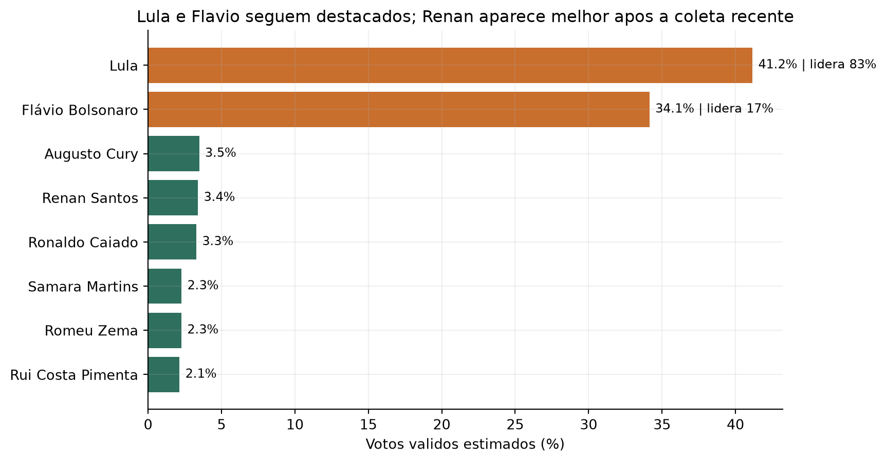

Nowcast principal: ensemble disciplinado

|  | candidato | voto_valido_estimado | medicoes | cobertura_pct | cobertura_status |
| --- | --- | --- | --- | --- | --- |
| 0 | Lula | 41.1596 | 18 | 100.0 | regular |
| 1 | Flávio Bolsonaro | 34.1465 | 18 | 100.0 | regular |
| 2 | Augusto Cury | 3.4810 | 18 | 100.0 | regular |
| 3 | Renan Santos | 3.3977 | 18 | 100.0 | regular |
| 4 | Ronaldo Caiado | 3.2859 | 18 | 100.0 | regular |
| 5 | Samara Martins | 2.2773 | 9 | 50.0 | regular |
| 6 | Romeu Zema | 2.2703 | 15 | 83.3 | regular |
| 7 | Rui Costa Pimenta | 2.1408 | 3 | 16.7 | baixa |
| 8 | Clariana Barão | 1.9869 | 2 | 11.1 | baixa |
| 9 | Edmilson Costa | 1.9869 | 2 | 11.1 | baixa |
| 10 | Hertz Dias | 1.9335 | 1 | 5.6 | baixa |
| 11 | Wilson Grassi | 1.9335 | 1 | 5.6 | baixa |

### Confianca da rodada

Esta secao resume se a previsao deve ser lida como sinal forte ou como fotografia ainda instavel. O placar combina apenas criterios auditaveis: recencia das pesquisas, quantidade de pesquisas no cenario operacional, auditoria de fontes, margem entre primeiro e segundo e erro historico do ensemble.

- **Pesquisas no cenario** — 18 (instituto-data-cenario)

- **Recencia** — 1 dias (ultima publicacao: 03/10/2026)

- **Auditoria recente** — 12/12 (fontes fortes ou confirmadas)

- **Margem lideranca** — 7,0% (quanto maior, mais estavel)

- **Erro vivo historico** — 7.30 p.p. (melhor modelo medio)

**Confianca operacional: ALTA (89/100).** A rodada esta bem alimentada e recente, mas a incerteza segue relevante porque a eleicao ainda esta longe e parte da base historica antiga ainda depende de auditoria complementar.

### Cenarios de 2026

|  | candidato | partido | vice | status_tse | uso_modelo | observacao |
| --- | --- | --- | --- | --- | --- | --- |
| 11 | Augusto Cury | Avante | Júlio Delgado | aprovado | entra no cenario operacional | Chapa validada pelo TSE |
| 10 | Clariana Barão | DC | Fabiana Torquato | aprovado | entra no cenario operacional | Chapa validada pelo TSE |
| 7 | Edmilson Costa | PCB | Cleusa Santos | aprovado | entra no cenario operacional | Chapa validada pelo TSE |
| 1 | Flávio Bolsonaro | PL | Alfredo Gaspar | aprovado | entra no cenario operacional | Chapa validada pelo TSE |
| 6 | Hertz Dias | PSTU | Vanessa Portugal | aprovado | entra no cenario operacional | Chapa validada pelo TSE |
| 0 | Lula | PT | Geraldo Alckmin | aprovado | entra no cenario operacional | Chapa validada pelo TSE |
| 8 | Renan Santos | Missão | Aroldo Medina | aprovado | entra no cenario operacional | Chapa validada pelo TSE |
| 5 | Romeu Zema | Novo | Eduardo Girão | aprovado | entra no cenario operacional | Chapa validada pelo TSE |
| 2 | Ronaldo Caiado | PSD | Gilberto Kassab | aprovado | entra no cenario operacional | Chapa validada pelo TSE |
| 3 | Rui Costa Pimenta | PCO | Antônio Carlos | aprovado | entra no cenario operacional | Chapa validada pelo TSE |
| 4 | Samara Martins | UP | Raquel Brício | aprovado | entra no cenario operacional | Chapa validada pelo TSE |
| 9 | Wilson Grassi | Democrata | Suêd Haidar | aprovado | entra no cenario operacional | Chapa validada pelo TSE |
| 12 | Pablo Marçal | PRTB | Leonardo Avalanche | indeferido | fora do cenario operacional | Registro negado pelo TSE; fora do cenário oper... |

|  | rotulo | familia | uso | prioridade | observacao |
| --- | --- | --- | --- | --- | --- |
| 50 | Primeiro turno 2026 - reta final em votos validos | alternativo | comparativo | 1 | Cenario de calibracao final com pesquisas em v... |
| 48 | Primeiro turno 2026 - Lula vs Flavio | comparativo antigo | comparativo | 2 | Cenario comparativo antigo sem Renan Santos ex... |
| 52 | Primeiro turno 2026 - agosto/setembro com Marcal | com Marcal | comparativo | 2 | Cenario alternativo com Pablo Marcal; fontes c... |
| 51 | Primeiro turno 2026 - agosto/setembro com Renan | alternativo | comparativo | 2 | Comparativo recente sem Pablo Marcal antes/dep... |
| 53 | Primeiro turno 2026 - Lula vs Flavio ampliado | comparativo antigo | comparativo | 3 | Cenario comparativo antigo com lista ampliada ... |
| 54 | Primeiro turno 2026 - alternativa com Tarcisio | alternativo | comparativo | 3 | Cenario alternativo |
| 55 | Primeiro turno 2026 - 2025 com Freitas/Gomes | alternativo | comparativo | 4 | Cenario antigo ou alternativo |
| 56 | Primeiro turno 2026 - cenario reduzido | alternativo | comparativo | 5 | Cenario reduzido; nao usar como principal |
| 49 | Primeiro turno 2026 - oficial pos-TSE | principal atual | operacional | 1 | Cenario operacional: pesquisas sem Pablo Marca... |

**Leitura:** o relatorio separa cenario operacional e cenarios alternativos. Isso evita misturar candidatos sem registro aprovado ou listas antigas com a previsao principal.

### O que mudou com as pesquisas novas

A coleta recente nao muda so o tamanho da base. Ela troca uma fotografia mais estreita da disputa por um cenario com Renan Santos e candidatos menores, que antes ficavam ausentes ou pouco visiveis na coleta automatica.

|  | candidato | cenario_anterior | cenario_recente | mudanca |
| --- | --- | --- | --- | --- |
| 5 | Lula | 47.52 | 41.16 | -6.36 |
| 3 | Flávio Bolsonaro | 36.53 | 34.15 | -2.39 |
| 0 | Augusto Cury | 6.77 | 3.48 | -3.29 |
| 6 | Renan Santos | NaN | 3.40 | NaN |
| 8 | Ronaldo Caiado | 5.14 | 3.29 | -1.85 |
| 10 | Samara Martins | NaN | 2.28 | NaN |
| 7 | Romeu Zema | 4.04 | 2.27 | -1.77 |
| 9 | Rui Costa Pimenta | NaN | 2.14 | NaN |
| 2 | Edmilson Costa | NaN | 1.99 | NaN |
| 1 | Clariana Barão | NaN | 1.99 | NaN |
| 4 | Hertz Dias | NaN | 1.93 | NaN |
| 11 | Wilson Grassi | NaN | 1.93 | NaN |

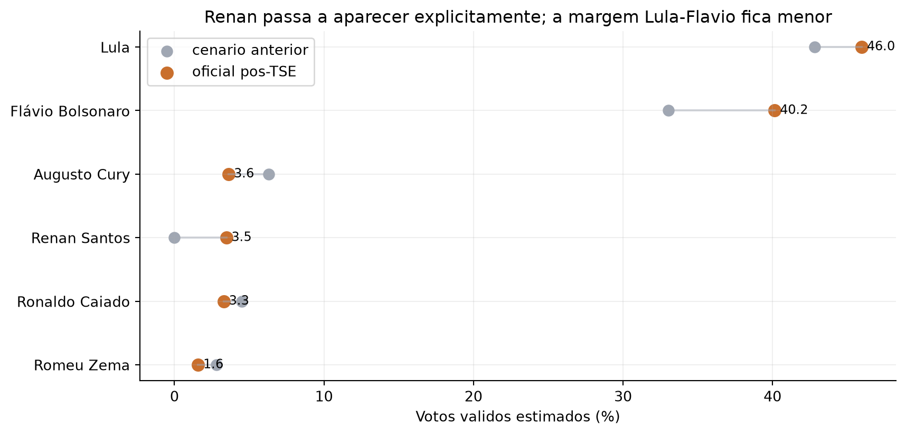

Impacto da coleta recente no cenario principal

**Coleta adicionada:** 267 linhas candidato-pesquisa manuais. Isso corresponde a 27 pesquisas/cenarios unicos recentes: 18 no cenario sem Marcal e 9 no cenario alternativo com Marcal.

### Historico de previsoes

Cada execucao do nowcast pode ser registrada como snapshot. Isso permite acompanhar como a previsao muda conforme novas pesquisas entram ou a base historica e revisada.

|  | data_registro | data_previsao |
| --- | --- | --- |
| 0 | 2026-09-12T22:07:19 | 2026-09-11 |
| 22 | 2026-09-12T22:07:35 | 2026-09-11 |
| 44 | 2026-09-24T21:46:45 | 2026-09-24 |
| 66 | 2026-09-24T22:35:31 | 2026-09-24 |
| 78 | 2026-09-24T23:34:48 | 2026-09-24 |
| 90 | 2026-09-25T09:20:26 | 2026-09-24 |
| 102 | 2026-09-25T09:32:11 | 2026-09-24 |
| 114 | 2026-09-25T10:24:39 | 2026-09-24 |

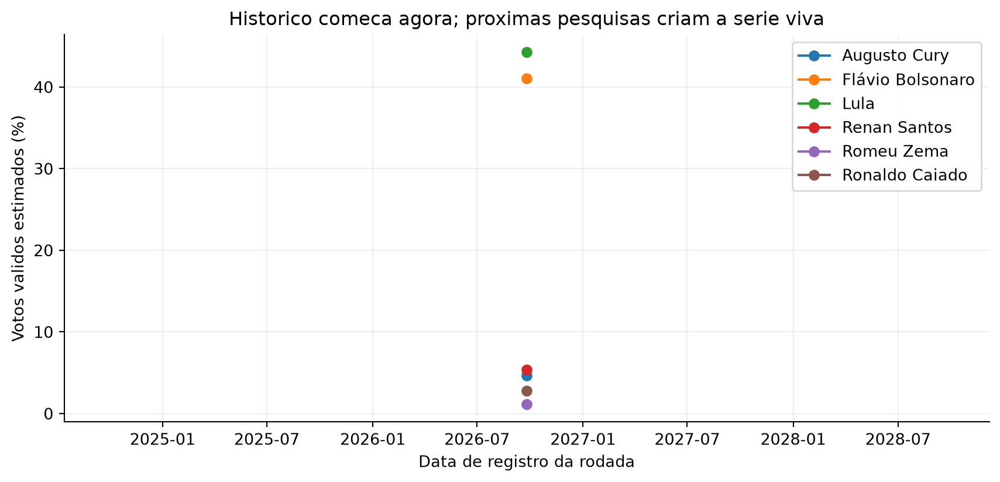

Evolucao registrada do nowcast por snapshot

### Fontes e referencias

As fontes entram em tres camadas:

1. **Resultado oficial:** Dados Abertos do TSE, para votos validos do primeiro turno.
2. **Pesquisas registradas:** PesqEle/TSE e fontes primarias dos institutos, para pesquisas atuais e historicas.
3. **Fundamentos objetivos:** variaveis politicas e economicas usadas na literatura de previsao eleitoral.

Referencias uteis para desenho do modelo:

- FiveThirtyEight/538: uso de medias de pesquisas, ajuste por qualidade do instituto, incerteza e simulacoes.
- The Economist: combinacao de pesquisas, fundamentos, estrutura hierarquica e simulacoes probabilisticas.
- Alan Abramowitz, *Time-for-Change*: aprovacao presidencial, crescimento economico e tempo do partido no poder.
- Douglas Hibbs, *Bread and Peace*: renda real e custo politico de guerras como explicadores do voto governista nos EUA.
- Cole Nussbaumer Knaflic, *Storytelling with Data*: foco em mensagem, remocao de ruido visual e destaque explicito do que importa.

### Variaveis do primeiro modelo

O baseline usa variaveis que saem diretamente das pesquisas ou de calendario:

- voto total do candidato na pesquisa;
- brancos, nulos e indecisos;
- voto valido estimado;
- instituto;
- tamanho da amostra;
- data de campo;
- data de publicacao;
- dias entre fim do campo e primeiro turno;
- dias entre publicacao e primeiro turno;
- ordem da pesquisa dentro do instituto e cenario;
- ordem geral da pesquisa na campanha.
- ajuste por vies historico do instituto, quando ha dados suficientes;
- efeito casa por instituto e candidato, quando ha dados suficientes;
- peso por qualidade historica do instituto.

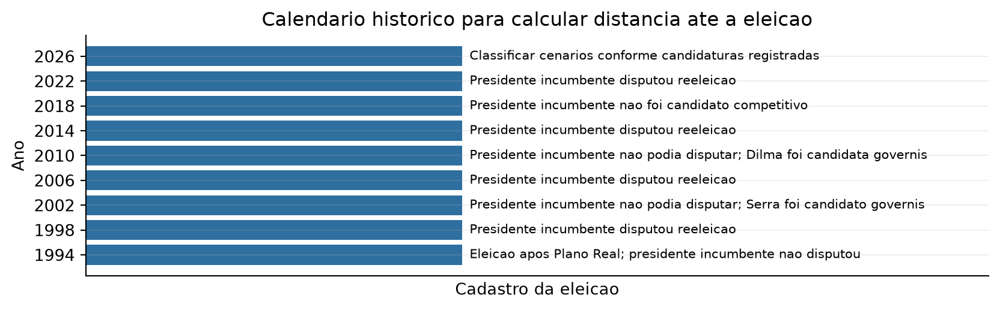

Eleicoes cadastradas no projeto

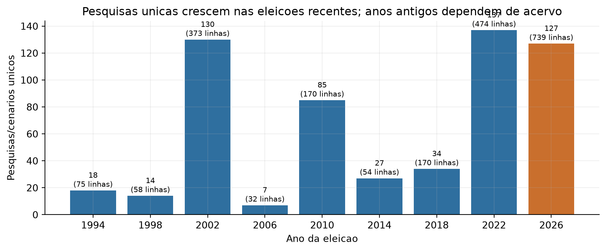

Pesquisas/cenarios unicos por eleicao

### Cobertura real da base

Uma linha do arquivo processado e uma combinacao candidato-pesquisa. Uma pesquisa com oito candidatos vira oito linhas. Para avaliar a cobertura real, a unidade correta e a combinacao `ano + instituto + data + cenario`.

|  | ano_eleicao | pesquisas_cenarios | linhas_candidato_pesquisa | institutos | candidatos | fonte_forte_pct | amostra_imputada_pct |
| --- | --- | --- | --- | --- | --- | --- | --- |
| 0 | 1994 | 18 | 75 | 2 | 7 | 83.3 | 83.3 |
| 1 | 1998 | 14 | 58 | 3 | 6 | 57.1 | 64.3 |
| 2 | 2002 | 130 | 373 | 6 | 6 | 0.8 | 99.2 |
| 3 | 2006 | 7 | 32 | 3 | 6 | 0.0 | 14.3 |
| 4 | 2010 | 85 | 170 | 11 | 2 | 0.0 | 100.0 |
| 5 | 2014 | 27 | 54 | 7 | 2 | 0.0 | 0.0 |
| 6 | 2018 | 34 | 170 | 13 | 5 | 0.0 | 0.0 |
| 7 | 2022 | 137 | 474 | 31 | 4 | 0.0 | 0.0 |
| 8 | 2026 | 127 | 739 | 21 | 13 | 1.6 | 0.0 |

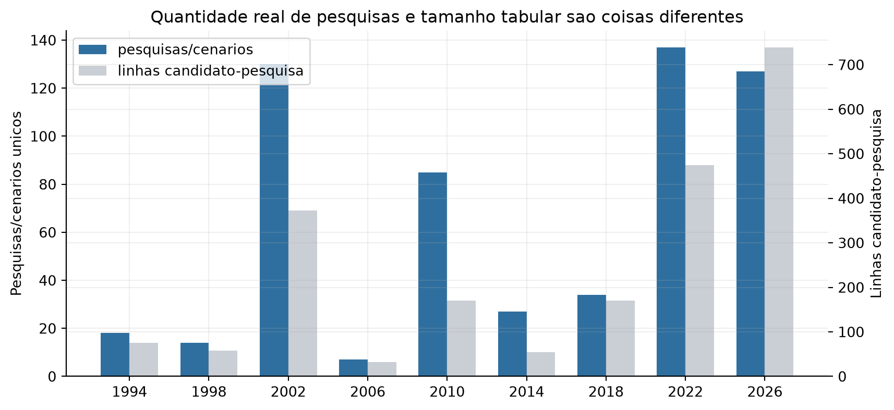

Linhas candidato-pesquisa versus pesquisas/cenarios unicos

### Qualidade da base historica

Esta leitura separa volume de confiabilidade. Uma eleicao pode ter muitas linhas e ainda depender de amostras imputadas, series consolidadas ou fontes secundarias. Isso importa porque o backtest deve punir menos um modelo quando a propria base historica daquele ano e fraca.

|  | ano_eleicao | categoria_fonte | pesquisas_cenarios | pct |
| --- | --- | --- | --- | --- |
| 0 | 1994 | fonte forte | 15 | 83.3 |
| 1 | 1994 | fonte secundaria auditada | 3 | 16.7 |
| 2 | 1998 | fonte forte | 8 | 57.1 |
| 3 | 1998 | fonte secundaria auditada | 6 | 42.9 |
| 5 | 2002 | fonte secundaria auditada | 129 | 99.2 |
| 4 | 2002 | fonte forte | 1 | 0.8 |
| 6 | 2006 | fonte secundaria auditada | 4 | 57.1 |
| 7 | 2006 | outra | 3 | 42.9 |
| 8 | 2010 | base agregada | 85 | 100.0 |
| 9 | 2014 | base agregada | 27 | 100.0 |
| 10 | 2018 | base agregada | 34 | 100.0 |
| 11 | 2022 | base agregada | 137 | 100.0 |
| 12 | 2026 | base agregada | 76 | 59.8 |
| 14 | 2026 | fonte secundaria auditada | 49 | 38.6 |
| 13 | 2026 | fonte forte | 2 | 1.6 |

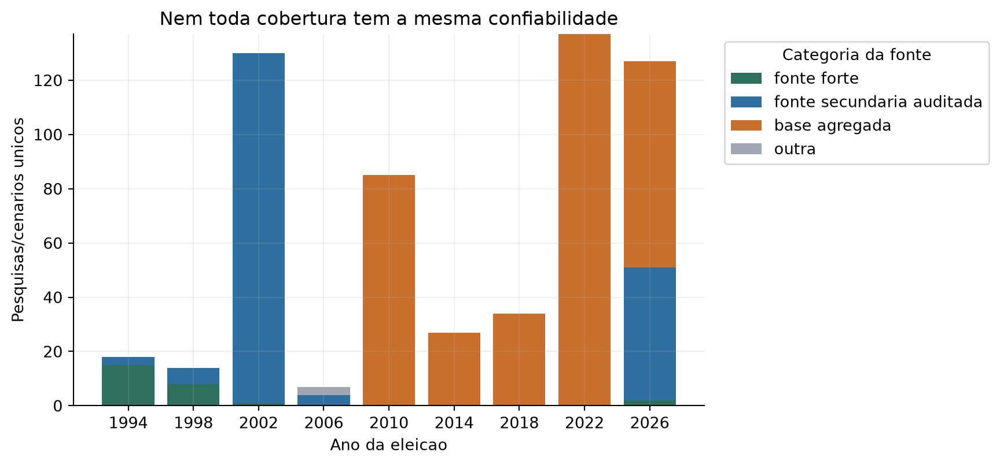

Composicao das fontes por ano

|  | ano_eleicao | pesquisas_cenarios | institutos | fonte_forte_pct | base_agregada_pct | amostra_imputada_pct | risco_leitura |
| --- | --- | --- | --- | --- | --- | --- | --- |
| 0 | 1994 | 18 | 2 | 83.3 | 0.0 | 83.3 | medio |
| 1 | 1998 | 14 | 3 | 57.1 | 0.0 | 64.3 | medio |
| 2 | 2002 | 130 | 6 | 0.8 | 0.0 | 99.2 | medio |
| 3 | 2006 | 7 | 3 | 0.0 | 0.0 | 14.3 | medio |
| 4 | 2010 | 85 | 11 | 0.0 | 100.0 | 100.0 | medio |
| 5 | 2014 | 27 | 7 | 0.0 | 100.0 | 0.0 | medio |
| 6 | 2018 | 34 | 13 | 0.0 | 100.0 | 0.0 | medio |
| 7 | 2022 | 137 | 31 | 0.0 | 100.0 | 0.0 | medio |
| 8 | 2026 | 127 | 21 | 1.6 | 59.8 | 0.0 | medio |

### Variaveis objetivas para incluir logo

A literatura e modelos profissionais costumam combinar pesquisas com fundamentos. Para o Brasil, algumas variaveis sao objetivas o suficiente para entrar cedo, desde que a fonte seja consistente:

- **incumbencia:** se o candidato e presidente tentando reeleicao;
- **sucessor governista:** candidato apoiado pelo presidente quando o presidente nao disputa;
- **tempo do grupo no poder:** quantos mandatos consecutivos o campo governista esta no governo;
- **aprovacao do governo:** percentual de otimo/bom, regular, ruim/pessimo ou aprovacao/desaprovacao;
- **economia:** inflacao, desemprego, crescimento do PIB, renda real e indicadores de percepcao economica;
- **rejeicao:** percentual que declara nao votar no candidato;
- **conhecimento do candidato:** quando disponivel em pesquisas;
- **metodo da pesquisa:** presencial, telefone, online ou misto;
- **qualidade historica do instituto:** erro medio passado e frequencia de pesquisas.

Essas variaveis devem ser comparadas por backtest. Se nao melhorarem a previsao fora da amostra, ficam como explicacao, nao como motor do modelo final.

|  | ano_eleicao | fundamentos_ano_referencia | pib_crescimento | inflacao | desemprego | fundamentos_defasagem_max |
| --- | --- | --- | --- | --- | --- | --- |
| 0 | 1994 | 1993 | 4.92 | 1927.38 | 6.03 | 1 |
| 1 | 1998 | 1997 | 3.39 | 6.93 | 9.00 | 1 |
| 2 | 2002 | 2001 | 1.39 | 6.84 | 10.65 | 1 |
| 3 | 2006 | 2005 | 3.20 | 6.87 | 10.55 | 1 |
| 4 | 2010 | 2009 | -0.13 | 4.89 | 9.42 | 1 |
| 5 | 2014 | 2013 | 3.00 | 6.20 | 7.07 | 1 |
| 6 | 2018 | 2017 | 1.32 | 3.45 | 12.79 | 1 |
| 7 | 2022 | 2021 | 4.76 | 8.30 | 13.16 | 1 |
| 8 | 2026 | 2025 | 2.29 | 5.02 | 5.97 | 1 |

### Organizacao dos dados

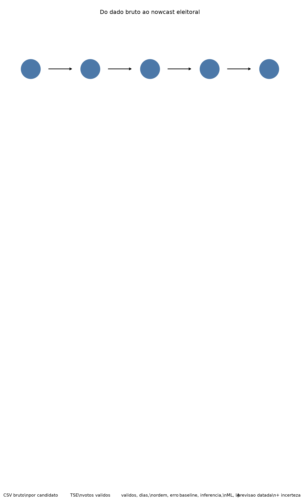

Fluxo dos dados ate a previsao

### Auditoria da base

O gargalo atual nao e algoritmo: e confiabilidade das series antigas. A base ja separa fonte, instituto, amostra imputada e cenario para permitir auditoria incremental. A busca mais recente adicionou Datafolha e Ibope para 1994 e 1998, mas ainda vale priorizar relatorios primarios completos e novas tabelas extraiveis desses anos.

|  | status_auditoria | pesquisas_cenarios |
| --- | --- | --- |
| 0 | fonte_primaria_confirmada | 16 |
| 2 | registro_e_metodologia_confirmados | 9 |
| 1 | fonte_primaria_localizada | 5 |
| 3 | registro_e_metodologia_confirmados_secundaria | 2 |
| 4 | relatorio_integral_confirmado_secundaria | 1 |

|  | entra_operacional | recorte_tse | cenario_status | status_auditoria | pesquisas_cenarios |
| --- | --- | --- | --- | --- | --- |
| 10 | sim | pos-TSE | operacional | fonte_primaria_confirmada | 5 |
| 11 | sim | pos-TSE | operacional | fonte_primaria_localizada | 3 |
| 12 | sim | pos-TSE | operacional | registro_e_metodologia_confirmados | 4 |
| 0 | nao | pos-TSE | outro | fonte_primaria_confirmada | 1 |
| 1 | nao | pos-TSE | outro | registro_e_metodologia_confirmados | 3 |
| 2 | nao | pos-TSE | outro | registro_e_metodologia_confirmados_secundaria | 2 |
| 3 | nao | pre-TSE | obsoleto: inclui Marcal | fonte_primaria_confirmada | 7 |
| 4 | nao | pre-TSE | obsoleto: inclui Marcal | fonte_primaria_localizada | 1 |
| 5 | nao | pre-TSE | obsoleto: inclui Marcal | registro_e_metodologia_confirmados | 1 |
| 6 | nao | pre-TSE | operacional | fonte_primaria_confirmada | 3 |
| 7 | nao | pre-TSE | operacional | fonte_primaria_localizada | 1 |
| 8 | nao | pre-TSE | operacional | registro_e_metodologia_confirmados | 1 |
| 9 | nao | pre-TSE | operacional | relatorio_integral_confirmado_secundaria | 1 |

|  | entra_operacional | instituto | data_publicacao | cenario | registro_tse | status_auditoria | observacao_auditoria |
| --- | --- | --- | --- | --- | --- | --- | --- |
| 26 | sim | Datafolha | 2026-09-24 | agosto_setembro_2026_sem_marcal | BR-00304/2026 | registro_e_metodologia_confirmados | Folha confirma campo amostra municipios contra... |
| 25 | sim | Palver | 2026-09-24 | agosto_setembro_2026_sem_marcal | BR-09587/2026 | fonte_primaria_confirmada | Pagina Palver Survey lista a onda W4 de setemb... |
| 24 | sim | RealTime Big Data | 2026-09-24 | agosto_setembro_2026_sem_marcal | BR-04202/2026 | fonte_primaria_localizada | Pagina oficial RealTime Big Data lista pesquis... |
| 23 | sim | AtlasIntel/Bloomberg | 2026-09-23 | agosto_setembro_2026_sem_marcal | BR-04739/2026 | fonte_primaria_confirmada | AtlasIntel confirma pesquisa nacional campo am... |
| 21 | sim | BTG/Nexus | 2026-09-21 | agosto_setembro_2026_sem_marcal | BR-00485/2026 | fonte_primaria_confirmada | Nexus confirma rodada campo amostra telefone C... |
| 22 | sim | Quaest | 2026-09-21 | agosto_setembro_2026_sem_marcal | BR-06004/2026 | fonte_primaria_localizada | Pagina oficial Quaest lista relatorio da rodad... |
| 19 | sim | AtlasIntel/Bloomberg | 2026-09-17 | agosto_setembro_2026_sem_marcal | BR-06221/2026 | fonte_primaria_confirmada | AtlasIntel confirma pesquisa nacional campo am... |
| 20 | sim | Datafolha | 2026-09-17 | agosto_setembro_2026_sem_marcal | BR-04029/2026 | registro_e_metodologia_confirmados | Folha confirma campo amostra municipios contra... |
| 16 | sim | CNT/MDA | 2026-09-15 | agosto_setembro_2026_sem_marcal | BR-06902/2026 | registro_e_metodologia_confirmados | Poder360 confirma campo amostra metodo margem ... |
| 17 | sim | BTG/Nexus | 2026-09-14 | agosto_setembro_2026_sem_marcal | BR-04076/2026 | fonte_primaria_confirmada | Nexus confirma rodada campo amostra telefone m... |
| 18 | sim | Quaest | 2026-09-14 | agosto_setembro_2026_sem_marcal | BR-03607/2026 | fonte_primaria_localizada | Pagina oficial Quaest lista relatorio da rodad... |
| 7 | sim | Datafolha | 2026-09-11 | agosto_setembro_2026_sem_marcal | BR-01833/2026 | registro_e_metodologia_confirmados | Folha/Datafolha confirma campo amostra cidades... |
| 29 | nao | AtlasIntel/Bloomberg | 2026-10-03 | outubro_2026_validos | BR-04391/2026 | registro_e_metodologia_confirmados | Poder360/CNN confirmam votos validos; UOL conf... |
| 31 | nao | CNT/MDA | 2026-10-03 | outubro_2026_validos | registro_nao_informado_na_fonte_secundaria | registro_e_metodologia_confirmados_secundaria | CNN consolida votos validos e margem 2,2 pp; D... |
| 27 | nao | Datafolha | 2026-10-03 | outubro_2026_validos | BR-01708/2026 | fonte_primaria_confirmada | Folha/Datafolha confirma votos validos da vesp... |
| 30 | nao | Futura/Apex | 2026-10-03 | outubro_2026_validos | BR-02431/2026 | registro_e_metodologia_confirmados_secundaria | Exame/CNN consolidam votos validos e metadados... |
| 32 | nao | Gerp | 2026-10-03 | outubro_2026_validos | BR-00509/2026 | registro_e_metodologia_confirmados | CNN confirma votos validos; Depois das 17 info... |
| 28 | nao | Quaest | 2026-10-03 | outubro_2026_validos | BR-02197/2026 | registro_e_metodologia_confirmados | CNN consolida votos validos e metadados: campo... |
| 1 | nao | AtlasIntel/Bloomberg | 2026-09-10 | agosto_setembro_2026_com_marcal | BR-01452/2026 | fonte_primaria_confirmada | AtlasIntel confirma pesquisa nacional campo am... |
| 13 | nao | PoderData/Aya | 2026-09-10 | agosto_setembro_2026_com_marcal | BR-04914/2026 | fonte_primaria_confirmada | Poder360/PoderData confirma campo amostra muni... |
| 9 | nao | Meio/Ideia | 2026-09-09 | agosto_setembro_2026_com_marcal | BR-07935/2026 | fonte_primaria_confirmada | Relatorio oficial Meio/Ideia de setembro confi... |
| 10 | nao | Palver | 2026-09-09 | agosto_setembro_2026_com_marcal | BR-05420/2026 | fonte_primaria_confirmada | Repositorio oficial Palver lista onda 2 divulg... |
| 11 | nao | Palver | 2026-09-09 | agosto_setembro_2026_sem_marcal | BR-05420/2026 | fonte_primaria_confirmada | Repositorio oficial Palver lista onda 2 divulg... |
| 4 | nao | BTG/Nexus | 2026-09-08 | agosto_setembro_2026_com_marcal | BR-06790/2026 | fonte_primaria_confirmada | Nexus confirma rodada campo amostra metodo mar... |
| 5 | nao | BTG/Nexus | 2026-09-08 | agosto_setembro_2026_sem_marcal | BR-06790/2026 | fonte_primaria_confirmada | Nexus confirma rodada campo amostra metodo mar... |
| 14 | nao | Quaest | 2026-09-07 | agosto_setembro_2026_com_marcal | BR-01720/2026 | fonte_primaria_localizada | Pagina oficial Quaest lista a rodada 3 de 07/0... |
| 15 | nao | Quaest | 2026-09-07 | agosto_setembro_2026_sem_marcal | BR-01720/2026 | fonte_primaria_localizada | Pagina oficial Quaest lista a rodada 3 de 07/0... |
| 6 | nao | Datafolha | 2026-09-03 | agosto_setembro_2026_sem_marcal | BR-03669/2026 | registro_e_metodologia_confirmados | Folha/Datafolha confirma campo amostra cidades... |
| 8 | nao | Futura/Apex | 2026-09-03 | agosto_setembro_2026_sem_marcal | BR-02793/2026 | relatorio_integral_confirmado_secundaria | CNN hospeda a integra do relatorio Futura/100%... |
| 0 | nao | AtlasIntel | 2026-08-31 | agosto_setembro_2026_com_marcal | BR-07972/2026 | registro_e_metodologia_confirmados | Poder360 confirma campo amostra margem registr... |
| 2 | nao | BTG/Nexus | 2026-08-31 | agosto_setembro_2026_com_marcal | BR-08900/2026 | fonte_primaria_confirmada | Nexus confirma rodada campo amostra metodo mar... |
| 3 | nao | BTG/Nexus | 2026-08-31 | agosto_setembro_2026_sem_marcal | BR-08900/2026 | fonte_primaria_confirmada | Nexus confirma rodada campo amostra metodo mar... |
| 12 | nao | PoderData/Aya | 2026-08-27 | agosto_setembro_2026_com_marcal | BR-04974/2026 | fonte_primaria_confirmada | Poder360/PoderData confirma campo amostra muni... |

|  | ano_eleicao | fonte | linhas | pesquisas_unicas | institutos | amostra_imputada | valor_fora_0_100 | primeira_publicacao | ultima_publicacao |
| --- | --- | --- | --- | --- | --- | --- | --- | --- | --- |
| 0 | 1994 | https://jornaisdesergipe.ufs.br/bitstream/1234... | 4 | 1 | 1 | 0 | 0 | 1994-04-01 | 1994-04-01 |
| 1 | 1994 | https://media.folha.uol.com.br/datafolha/2022/... | 60 | 15 | 1 | 60 | 0 | 1994-04-05 | 1994-10-01 |
| 2 | 1994 | https://www1.folha.uol.com.br/fsp/1994/5/27/br... | 5 | 1 | 1 | 0 | 0 | 1994-05-27 | 1994-05-27 |
| 3 | 1994 | https://www1.folha.uol.com.br/fsp/1994/8/23/ca... | 6 | 1 | 1 | 0 | 0 | 1994-08-23 | 1994-08-23 |
| 4 | 1998 | https://media.folha.uol.com.br/datafolha/2022/... | 32 | 8 | 1 | 32 | 0 | 1998-03-11 | 1998-10-02 |
| 5 | 1998 | https://www.folhadelondrina.com.br/politica/fe... | 4 | 1 | 1 | 0 | 0 | 1998-07-30 | 1998-07-30 |
| 6 | 1998 | https://www.folhadelondrina.com.br/politica/fh... | 5 | 1 | 1 | 0 | 0 | 1998-09-16 | 1998-09-16 |
| 7 | 1998 | https://www.folhadelondrina.com.br/politica/pe... | 4 | 1 | 1 | 0 | 0 | 1998-05-27 | 1998-05-27 |
| 8 | 1998 | https://www1.folha.uol.com.br/fol/pol/po050698... | 4 | 1 | 1 | 0 | 0 | 1998-06-05 | 1998-06-05 |
| 9 | 1998 | https://www1.folha.uol.com.br/fsp/brasil/fc120... | 4 | 1 | 1 | 4 | 0 | 1998-07-12 | 1998-07-12 |
| 10 | 1998 | https://www1.folha.uol.com.br/fsp/brasil/fc180... | 5 | 1 | 1 | 0 | 0 | 1998-08-18 | 1998-08-18 |
| 11 | 2002 | https://www.cesop.unicamp.br/vw/1I8v7SqswNQ_MD... | 6 | 1 | 1 | 0 | 0 | 2002-09-09 | 2002-09-09 |
| 12 | 2002 | https://www1.uol.com.br/fernandorodrigues/arqu... | 367 | 129 | 6 | 367 | 0 | 2002-01-04 | 2002-10-05 |
| 13 | 2006 | Wikipedia pt 2006 wikitext: pesquisa de primei... | 14 | 3 | 2 | 0 | 0 | 2006-09-08 | 2006-09-30 |
| 14 | 2006 | https://www1.folha.uol.com.br/fsp/brasil/fc020... | 5 | 1 | 1 | 0 | 0 | 2006-09-02 | 2006-09-02 |
| 15 | 2006 | https://www1.folha.uol.com.br/fsp/brasil/fc060... | 5 | 1 | 1 | 5 | 0 | 2006-09-06 | 2006-09-06 |
| 16 | 2006 | https://www1.folha.uol.com.br/fsp/brasil/fc200... | 4 | 1 | 1 | 0 | 0 | 2006-09-20 | 2006-09-20 |
| 17 | 2006 | https://www1.folha.uol.com.br/fsp/brasil/fc280... | 4 | 1 | 1 | 0 | 0 | 2006-09-28 | 2006-09-28 |
| 18 | 2010 | https://en.wikipedia.org/wiki/Opinion_polling_... | 170 | 85 | 11 | 170 | 0 | 2008-11-28 | 2010-10-02 |
| 19 | 2014 | https://en.wikipedia.org/wiki/2014_Brazilian_g... | 54 | 27 | 7 | 0 | 0 | 2014-02-15 | 2014-10-05 |
| 20 | 2018 | https://en.wikipedia.org/wiki/Opinion_polling_... | 170 | 34 | 13 | 0 | 0 | 2018-09-02 | 2018-10-05 |
| 21 | 2022 | https://en.wikipedia.org/wiki/Opinion_polling_... | 474 | 137 | 31 | 0 | 0 | 2022-01-09 | 2022-10-01 |
| 22 | 2026 | https://en.wikipedia.org/wiki/Opinion_polling_... | 349 | 76 | 14 | 0 | 0 | 2025-02-27 | 2026-09-10 |
| 23 | 2026 | https://exame.com/brasil/pesquisa-para-preside... | 14 | 2 | 1 | 0 | 0 | 2026-10-03 | 2026-10-03 |
| 24 | 2026 | https://noticias.uol.com.br/eleicoes/2026/08/3... | 10 | 1 | 1 | 0 | 0 | 2026-08-31 | 2026-08-31 |
| 25 | 2026 | https://noticias.uol.com.br/eleicoes/2026/08/3... | 38 | 3 | 2 | 0 | 0 | 2026-08-27 | 2026-08-31 |
| 26 | 2026 | https://noticias.uol.com.br/eleicoes/2026/09/0... | 7 | 1 | 1 | 0 | 0 | 2026-09-07 | 2026-09-07 |
| 27 | 2026 | https://noticias.uol.com.br/eleicoes/2026/09/0... | 18 | 2 | 2 | 0 | 0 | 2026-09-03 | 2026-09-08 |
| 28 | 2026 | https://noticias.uol.com.br/eleicoes/2026/09/1... | 65 | 7 | 6 | 0 | 0 | 2026-09-07 | 2026-09-10 |
| 29 | 2026 | https://noticias.uol.com.br/eleicoes/2026/09/1... | 10 | 2 | 1 | 0 | 0 | 2026-09-15 | 2026-09-15 |
| 30 | 2026 | https://noticias.uol.com.br/eleicoes/2026/09/1... | 26 | 4 | 2 | 0 | 0 | 2026-09-14 | 2026-09-14 |
| 31 | 2026 | https://noticias.uol.com.br/eleicoes/2026/09/2... | 40 | 6 | 3 | 0 | 0 | 2026-09-21 | 2026-09-24 |
| 32 | 2026 | https://noticias.uol.com.br/eleicoes/2026/09/2... | 12 | 2 | 1 | 0 | 0 | 2026-09-24 | 2026-09-24 |
| 33 | 2026 | https://www.band.com.br/politica/eleicoes/atla... | 24 | 2 | 1 | 0 | 0 | 2026-09-17 | 2026-09-17 |
| 34 | 2026 | https://www.cnnbrasil.com.br/eleicoes/atlas-bl... | 12 | 2 | 1 | 0 | 0 | 2026-09-23 | 2026-09-23 |
| 35 | 2026 | https://www.cnnbrasil.com.br/eleicoes/eleicoes... | 24 | 4 | 2 | 0 | 0 | 2026-10-03 | 2026-10-03 |
| 36 | 2026 | https://www.cnnbrasil.com.br/eleicoes/gerp-fla... | 12 | 2 | 1 | 0 | 0 | 2026-10-03 | 2026-10-03 |
| 37 | 2026 | https://www.poder360.com.br/poder-eleicoes-202... | 10 | 2 | 1 | 0 | 0 | 2026-10-03 | 2026-10-03 |
| 38 | 2026 | https://www1.folha.uol.com.br/poder/2026/09/da... | 16 | 2 | 1 | 0 | 0 | 2026-09-17 | 2026-09-17 |
| 39 | 2026 | https://www1.folha.uol.com.br/poder/2026/09/da... | 20 | 2 | 1 | 0 | 0 | 2026-09-11 | 2026-09-11 |
| 40 | 2026 | https://www1.folha.uol.com.br/poder/2026/09/da... | 14 | 2 | 1 | 0 | 0 | 2026-09-24 | 2026-09-24 |
| 41 | 2026 | https://www1.folha.uol.com.br/poder/2026/09/da... | 6 | 1 | 1 | 0 | 0 | 2026-09-03 | 2026-09-03 |
| 42 | 2026 | https://www1.folha.uol.com.br/poder/2026/10/da... | 12 | 2 | 1 | 0 | 0 | 2026-10-03 | 2026-10-03 |

### Analise exploratoria planejada

Assim que a base de pesquisas estiver preenchida, os primeiros graficos devem responder:

- quais institutos aparecem por ano;
- quantas pesquisas existem por semana de campanha;
- como cada candidato evolui em votos validos estimados;
- como o erro historico muda conforme a eleicao se aproxima;
- se algum instituto tem viés medio recorrente;
- se pesquisas online, presenciais e telefonicas se comportam diferente;
- se rejeicao, aprovacao do governo e economia ajudam alem das pesquisas.

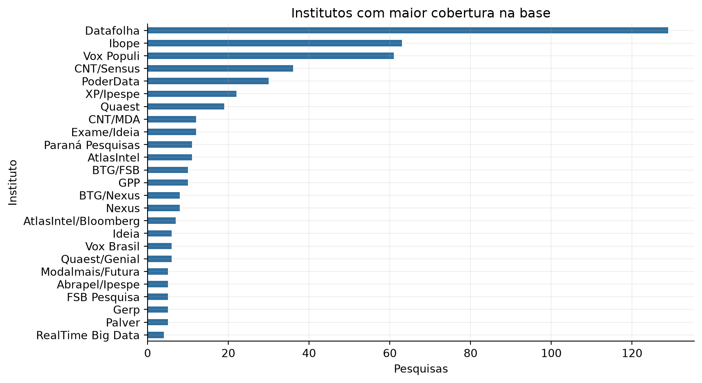

Cobertura atual de pesquisas por instituto

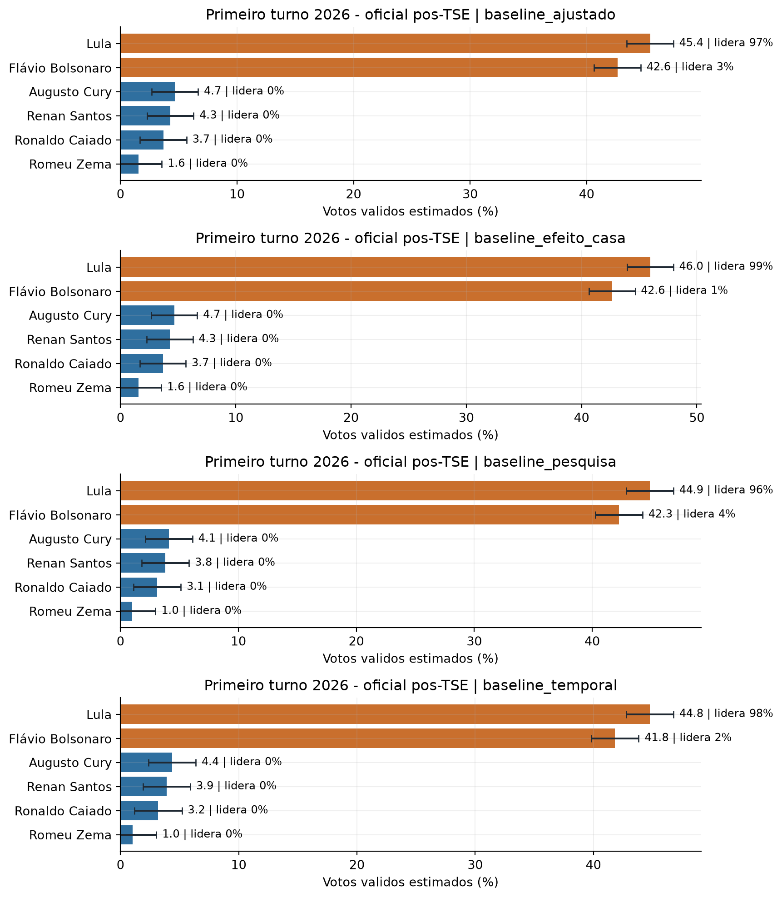

Previsao atual por cenario principal de 2026

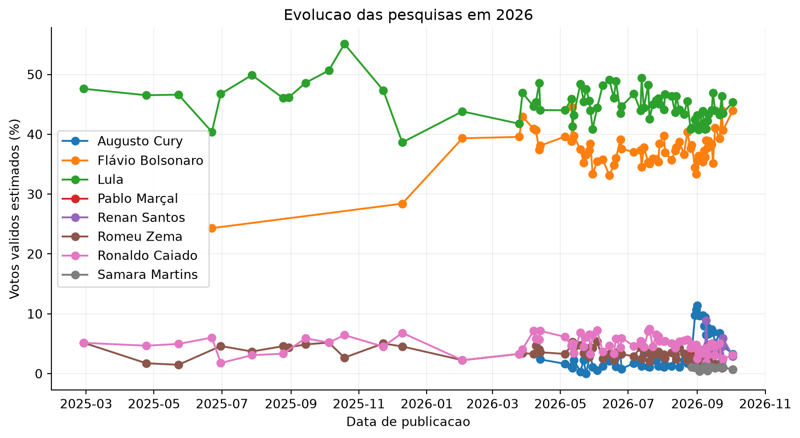

Evolucao de votos validos estimados

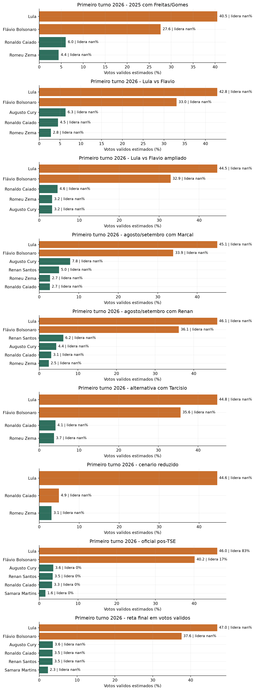

Previsao final do ensemble disciplinado

### Modelos

Uma revisao mais completa da literatura esta em `docs/revisao-literatura-metodos.md`. A leitura principal e simples: pesquisas dominam perto da eleicao; fundamentos ajudam longe da eleicao; modelos Bayesianos dinamicos sao a evolucao estatistica mais natural; ML, redes neurais e ensembles entram como desafiantes do baseline, nao como substitutos automaticos.

|  | modelo | status | papel no relatorio |
| --- | --- | --- | --- |
| 0 | ensemble_disciplinado | Producao | Combina baseline e Bayesiano dinamico com peso... |
| 1 | baseline_pesquisa | Referencia | Media ponderada por pesquisas; e o rival minim... |
| 2 | bayesiano_dinamico_kalman | Producao assistida | Estado latente temporal; melhora incerteza e l... |
| 3 | random_forest_07_600 / gradient_boosting | Experimental | ML tabular competitivo, mas ainda instavel ent... |
| 4 | mlp_pequena | Experimental | Deep learning pequeno; mantido como teste, nao... |
| 5 | voting_ia / stacking_ia | Experimental | IA/ensemble supervisionado; so entra se vencer... |

|  | modelo | mae |
| --- | --- | --- |
| 9 | extra_trees_1000 | 5.96 |
| 35 | voting_arvores_ia | 6.05 |
| 5 | extra_trees | 6.13 |
| 3 | baseline_pesquisa | 6.14 |
| 16 | hist_gradient_boosting_l2 | 6.22 |
| 15 | hist_gradient_boosting | 6.23 |
| 8 | extra_trees_05_2000_leaf3 | 6.24 |
| 23 | random_forest_05_1200 | 6.24 |

#### Baseline

Media ponderada por recencia e amostra. Tambem ha versoes com qualidade historica do instituto e efeito casa por instituto-candidato. O baseline puro continua sendo o primeiro rival a ser batido.

#### Inferencia

Modelo para explicar erro historico:

```text
erro ~ dias_ate_eleicao + incumbente + sucessor_governo + aprovacao_governo + economia + metodo + instituto
```

#### Machine learning

Modelos candidatos:

- regressao regularizada;
- random forest;
- gradient boosting;
- ensemble simples.

#### IA e deep learning

So entram depois de backtest suficiente. A base presidencial brasileira e pequena, entao uma rede neural deve ser pequena e tratada como experimento, nao como previsao principal.

|  | familia | referencia conceitual | modelo no projeto | papel |
| --- | --- | --- | --- | --- |
| 0 | Media de pesquisas | Agregacao de pesquisas recentes | baseline_pesquisa | Referencia principal |
| 1 | Inferencia | Regressao explicavel para erro e variaveis pol... | inferencial_ols | Diagnostico |
| 2 | ML tabular | Regularizacao, margem, arvores e boosting | ridge, elastic_net, huber, svr_rbf, random_for... | Desafiantes |
| 3 | Deep learning | MLP tabular pequena/media/profunda | mlp_pequena, mlp_media, mlp_profunda | Experimental |
| 4 | Efeito casa | Correcao por vies historico de instituto-candi... | baseline_efeito_casa | Melhor baseline atual |
| 5 | IA / ensemble | Combinacao disciplinada de modelos | voting_ia, stacking_ia, ensemble_pesos | Auxiliar |
| 6 | Bayesiano dinamico | Estado latente da corrida no tempo | bayesiano_dinamico_kalman | Nowcast robusto em teste |

#### Bayesiano dinamico

O `bayesiano_dinamico_kalman` trata a corrida como estado latente diario. Cada pesquisa e uma observacao ruidosa dessa trajetoria; o filtro de Kalman estima o nivel atual e projeta ate o primeiro turno com intervalo de incerteza. E mais honesto que a tendencia linear simples porque separa ruido observado de movimento temporal estimado.

No backtest vivo inicial, ele quase empata com o `baseline_temporal` e supera os baselines nao temporais. Por isso, entra no ensemble disciplinado com peso condicionado ao desempenho na previsao viva.

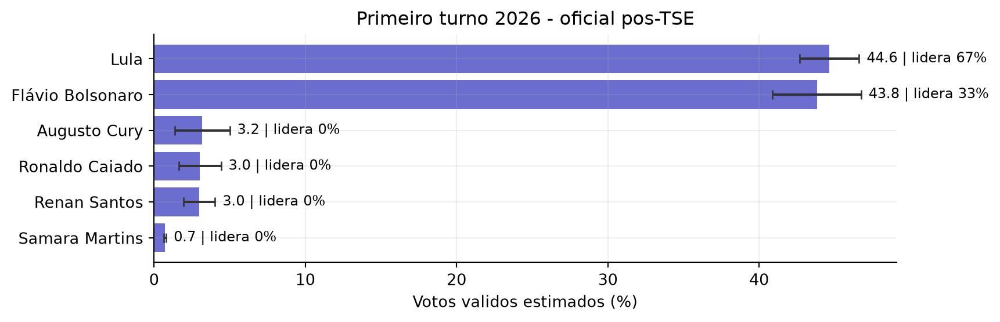

Previsao 2026 pelo estado latente dinamico

|  | cenario | candidato | voto_valido_estimado | intervalo_baixo | intervalo_alto | probabilidade_liderar | probabilidade_ir_ao_segundo_turno | metodo_estado_latente |
| --- | --- | --- | --- | --- | --- | --- | --- | --- |
| 0 | Primeiro turno 2026 - oficial pos-TSE | Lula | 44.6404 | 42.6655 | 46.6153 | 0.6704 | 1.0 | kalman_local_level |
| 1 | Primeiro turno 2026 - oficial pos-TSE | Flávio Bolsonaro | 43.8157 | 40.8852 | 46.7462 | 0.3296 | 1.0 | kalman_local_level |
| 2 | Primeiro turno 2026 - oficial pos-TSE | Augusto Cury | 3.1843 | 1.3681 | 5.0005 | 0.0000 | 0.0 | kalman_local_level |
| 3 | Primeiro turno 2026 - oficial pos-TSE | Ronaldo Caiado | 3.0250 | 1.6252 | 4.4247 | 0.0000 | 0.0 | kalman_local_level |
| 4 | Primeiro turno 2026 - oficial pos-TSE | Renan Santos | 2.9909 | 1.9473 | 4.0345 | 0.0000 | 0.0 | kalman_local_level |
| 5 | Primeiro turno 2026 - oficial pos-TSE | Samara Martins | 0.7137 | 0.6234 | 0.8039 | 0.0000 | 0.0 | kalman_local_level |
| 6 | Primeiro turno 2026 - oficial pos-TSE | Romeu Zema | 0.6524 | 0.3422 | 0.9626 | 0.0000 | 0.0 | kalman_local_level |
| 7 | Primeiro turno 2026 - oficial pos-TSE | Rui Costa Pimenta | 0.4254 | 0.0000 | 1.3489 | 0.0000 | 0.0 | kalman_local_level |
| 8 | Primeiro turno 2026 - oficial pos-TSE | Clariana Barão | 0.0000 | 0.0000 | 1.4965 | 0.0000 | 0.0 | kalman_local_level |
| 9 | Primeiro turno 2026 - oficial pos-TSE | Edmilson Costa | 0.0000 | 0.0000 | 1.4965 | 0.0000 | 0.0 | kalman_local_level |
| 10 | Primeiro turno 2026 - oficial pos-TSE | Hertz Dias | 0.0000 | 0.0000 | 10.0000 | 0.0000 | 0.0 | fallback_poucos_pontos |
| 11 | Primeiro turno 2026 - oficial pos-TSE | Wilson Grassi | 0.0000 | 0.0000 | 10.0000 | 0.0000 | 0.0 | fallback_poucos_pontos |

|  | instituto | linhas | vies_medio | mae |
| --- | --- | --- | --- | --- |
| 0 | Atlas | 16 | 0.35 | 1.67 |
| 1 | Arko/Atlas | 4 | 0.14 | 2.03 |
| 2 | BTG Pactual/FSB | 4 | 0.51 | 2.76 |
| 3 | IstoÉ/Sensus | 5 | 0.89 | 2.79 |
| 4 | Genial/Quaest | 16 | 0.12 | 2.94 |
| 5 | Instituto Veritá 2018-10-07 at the Wayback Mac... | 5 | 0.29 | 2.98 |
| 6 | Ibope (exit poll) | 2 | 0.57 | 2.98 |
| 7 | Paraná Pesquisas/Crusoé 2018-10-06 at the Wayb... | 5 | 1.05 | 3.07 |
| 8 | Revista Fórum/Offerwise | 2 | -1.58 | 3.08 |
| 9 | IPEC | 8 | 0.12 | 3.38 |
| 10 | FSB Comunicação | 8 | 0.68 | 3.42 |
| 11 | Abrapel/Ipespe | 20 | 0.28 | 3.45 |
| 12 | CNT/MDA 2018-09-30 at the Wayback Machine | 5 | 0.98 | 3.62 |
| 13 | Quaest | 4 | 0.27 | 3.75 |
| 14 | Globo/Ipec | 8 | 0.27 | 4.01 |
| 15 | CNT/MDA | 29 | 1.99 | 4.16 |
| 16 | Ipec | 12 | 0.08 | 4.22 |
| 17 | Datafolha 2010-08-20 at the Wayback Machine | 2 | -4.29 | 4.29 |
| 18 | PoderData | 74 | 2.05 | 4.33 |
| 20 | BTG/FSB | 36 | 0.46 | 4.33 |

|  | instituto | candidato | linhas | vies_medio | mae |
| --- | --- | --- | --- | --- | --- |
| 0 | Exame/Ideia | Simone Tebet | 3 | -0.41 | 0.41 |
| 1 | PoderData | Simone Tebet | 8 | -0.00 | 0.44 |
| 2 | XP/Ipespe | Simone Tebet | 3 | -0.47 | 0.47 |
| 3 | Datafolha | Cristovam Buarque | 4 | 0.72 | 0.72 |
| 4 | Genial/Quaest | Simone Tebet | 4 | -0.83 | 0.83 |
| 5 | Genial/Quaest | Lula | 4 | -0.32 | 0.97 |
| 7 | Ibope | João Amoêdo | 6 | -1.11 | 1.11 |
| 6 | Ipec | Simone Tebet | 3 | -0.63 | 1.11 |
| 8 | Abrapel/Ipespe | Simone Tebet | 5 | -1.13 | 1.13 |
| 9 | Datafolha | João Amoêdo | 5 | -1.13 | 1.13 |
| 10 | Atlas | Ciro Gomes | 4 | -1.37 | 1.37 |
| 11 | Atlas | Simone Tebet | 4 | 1.41 | 1.41 |
| 12 | Datafolha | Simone Tebet | 8 | -0.49 | 1.48 |
| 13 | Atlas | Lula | 4 | -1.07 | 1.49 |
| 14 | Abrapel/Ipespe | Lula | 5 | 0.74 | 1.58 |
| 15 | BTG/FSB | Simone Tebet | 6 | -0.69 | 1.62 |
| 16 | XP/Ipespe | João Amoêdo | 5 | -1.82 | 1.82 |
| 17 | BTG/FSB | Lula | 10 | 1.35 | 1.96 |
| 18 | Paraná Pesquisas | Simone Tebet | 4 | 2.01 | 2.01 |
| 19 | FSB Pesquisa | João Amoêdo | 5 | -2.18 | 2.18 |

### Criterio de comparacao

Cada modelo deve ser avaliado por backtest historico:

- erro medio absoluto por candidato;
- acerto dos dois candidatos no segundo turno;
- erro do primeiro colocado;
- calibracao dos intervalos;
- estabilidade da previsao ao adicionar novas pesquisas.

### Avaliacao cronologica

Esta avaliacao responde diretamente: se o projeto existisse antes de cada eleicao historica, o que ele teria previsto usando apenas eleicoes anteriores? Com a coleta de 2006, agora tambem entram testes para 2010 e 2014, antes dos testes principais de 2018 e 2022.

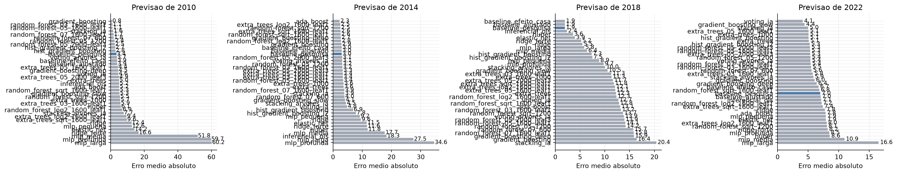

Backtest cronologico: treina no passado e prevê a eleicao seguinte

|  | ano_eleicao | ano_treino_max | modelo | cenario_rotulo | candidato | previsto | resultado_real_validos | erro_abs |
| --- | --- | --- | --- | --- | --- | --- | --- | --- |
| 59 | 2010 | 2006 | ada_boost | Primeiro turno 2010 | José Serra | 37.70 | 32.61 | 5.09 |
| 58 | 2010 | 2006 | ada_boost | Primeiro turno 2010 | Dilma Rousseff | 41.66 | 46.91 | 5.25 |
| 3 | 2010 | 2006 | baseline_ajustado | Primeiro turno 2010 | José Serra | 33.08 | 32.61 | 0.47 |
| 2 | 2010 | 2006 | baseline_ajustado | Primeiro turno 2010 | Dilma Rousseff | 54.17 | 46.91 | 7.26 |
| 5 | 2010 | 2006 | baseline_efeito_casa | Primeiro turno 2010 | José Serra | 33.08 | 32.61 | 0.47 |
| 4 | 2010 | 2006 | baseline_efeito_casa | Primeiro turno 2010 | Dilma Rousseff | 54.17 | 46.91 | 7.26 |
| 1 | 2010 | 2006 | baseline_pesquisa | Primeiro turno 2010 | José Serra | 30.98 | 32.61 | 1.63 |
| 0 | 2010 | 2006 | baseline_pesquisa | Primeiro turno 2010 | Dilma Rousseff | 52.07 | 46.91 | 5.16 |
| 13 | 2010 | 2006 | elastic_net | Primeiro turno 2010 | José Serra | 38.16 | 32.61 | 5.55 |
| 12 | 2010 | 2006 | elastic_net | Primeiro turno 2010 | Dilma Rousseff | 69.66 | 46.91 | 22.75 |
| 34 | 2010 | 2006 | extra_trees | Primeiro turno 2010 | Dilma Rousseff | 50.45 | 46.91 | 3.54 |
| 35 | 2010 | 2006 | extra_trees | Primeiro turno 2010 | José Serra | 26.23 | 32.61 | 6.38 |
| 38 | 2010 | 2006 | extra_trees_03_1600_leaf1 | Primeiro turno 2010 | Dilma Rousseff | 42.44 | 46.91 | 4.47 |
| 39 | 2010 | 2006 | extra_trees_03_1600_leaf1 | Primeiro turno 2010 | José Serra | 25.34 | 32.61 | 7.27 |
| 40 | 2010 | 2006 | extra_trees_05_1600_leaf1 | Primeiro turno 2010 | Dilma Rousseff | 44.53 | 46.91 | 2.38 |
| 41 | 2010 | 2006 | extra_trees_05_1600_leaf1 | Primeiro turno 2010 | José Serra | 26.28 | 32.61 | 6.33 |
| 46 | 2010 | 2006 | extra_trees_05_2000_leaf3 | Primeiro turno 2010 | Dilma Rousseff | 50.35 | 46.91 | 3.44 |
| 47 | 2010 | 2006 | extra_trees_05_2000_leaf3 | Primeiro turno 2010 | José Serra | 26.18 | 32.61 | 6.43 |
| 36 | 2010 | 2006 | extra_trees_1000 | Primeiro turno 2010 | Dilma Rousseff | 51.96 | 46.91 | 5.05 |
| 37 | 2010 | 2006 | extra_trees_1000 | Primeiro turno 2010 | José Serra | 26.26 | 32.61 | 6.35 |
| 45 | 2010 | 2006 | extra_trees_log2_1600_leaf1 | Primeiro turno 2010 | José Serra | 24.48 | 32.61 | 8.13 |
| 44 | 2010 | 2006 | extra_trees_log2_1600_leaf1 | Primeiro turno 2010 | Dilma Rousseff | 36.16 | 46.91 | 10.75 |
| 43 | 2010 | 2006 | extra_trees_sqrt_1600_leaf1 | Primeiro turno 2010 | José Serra | 24.11 | 32.61 | 8.50 |
| 42 | 2010 | 2006 | extra_trees_sqrt_1600_leaf1 | Primeiro turno 2010 | Dilma Rousseff | 36.14 | 46.91 | 10.77 |
| 48 | 2010 | 2006 | gradient_boosting | Primeiro turno 2010 | Dilma Rousseff | 46.75 | 46.91 | 0.16 |
| 49 | 2010 | 2006 | gradient_boosting | Primeiro turno 2010 | José Serra | 31.20 | 32.61 | 1.41 |
| 53 | 2010 | 2006 | gradient_boosting_deep | Primeiro turno 2010 | José Serra | 31.22 | 32.61 | 1.39 |
| 52 | 2010 | 2006 | gradient_boosting_deep | Primeiro turno 2010 | Dilma Rousseff | 54.53 | 46.91 | 7.62 |
| 50 | 2010 | 2006 | gradient_boosting_slow | Primeiro turno 2010 | Dilma Rousseff | 51.14 | 46.91 | 4.23 |
| 51 | 2010 | 2006 | gradient_boosting_slow | Primeiro turno 2010 | José Serra | 38.99 | 32.61 | 6.38 |
| 55 | 2010 | 2006 | hist_gradient_boosting | Primeiro turno 2010 | José Serra | 32.32 | 32.61 | 0.29 |
| 54 | 2010 | 2006 | hist_gradient_boosting | Primeiro turno 2010 | Dilma Rousseff | 52.28 | 46.91 | 5.37 |
| 57 | 2010 | 2006 | hist_gradient_boosting_l2 | Primeiro turno 2010 | José Serra | 33.00 | 32.61 | 0.39 |
| 56 | 2010 | 2006 | hist_gradient_boosting_l2 | Primeiro turno 2010 | Dilma Rousseff | 51.87 | 46.91 | 4.96 |
| 10 | 2010 | 2006 | huber | Primeiro turno 2010 | Dilma Rousseff | 52.44 | 46.91 | 5.53 |
| 11 | 2010 | 2006 | huber | Primeiro turno 2010 | José Serra | 26.00 | 32.61 | 6.61 |
| 7 | 2010 | 2006 | inferencial_ols | Primeiro turno 2010 | José Serra | 28.81 | 32.61 | 3.80 |
| 6 | 2010 | 2006 | inferencial_ols | Primeiro turno 2010 | Dilma Rousseff | 53.41 | 46.91 | 6.50 |
| 66 | 2010 | 2006 | mlp_larga | Primeiro turno 2010 | Dilma Rousseff | 100.00 | 46.91 | 53.09 |
| 67 | 2010 | 2006 | mlp_larga | Primeiro turno 2010 | José Serra | 100.00 | 32.61 | 67.39 |
| 62 | 2010 | 2006 | mlp_media | Primeiro turno 2010 | Dilma Rousseff | 96.65 | 46.91 | 49.74 |
| 63 | 2010 | 2006 | mlp_media | Primeiro turno 2010 | José Serra | 86.42 | 32.61 | 53.81 |
| 61 | 2010 | 2006 | mlp_pequena | Primeiro turno 2010 | José Serra | 37.81 | 32.61 | 5.20 |
| 60 | 2010 | 2006 | mlp_pequena | Primeiro turno 2010 | Dilma Rousseff | 66.84 | 46.91 | 19.93 |
| 64 | 2010 | 2006 | mlp_profunda | Primeiro turno 2010 | Dilma Rousseff | 100.00 | 46.91 | 53.09 |
| 65 | 2010 | 2006 | mlp_profunda | Primeiro turno 2010 | José Serra | 99.01 | 32.61 | 66.40 |
| 22 | 2010 | 2006 | random_forest_03_1600_leaf1 | Primeiro turno 2010 | Dilma Rousseff | 46.12 | 46.91 | 0.79 |
| 23 | 2010 | 2006 | random_forest_03_1600_leaf1 | Primeiro turno 2010 | José Serra | 31.25 | 32.61 | 1.36 |
| 19 | 2010 | 2006 | random_forest_05_1200 | Primeiro turno 2010 | José Serra | 31.43 | 32.61 | 1.18 |
| 18 | 2010 | 2006 | random_forest_05_1200 | Primeiro turno 2010 | Dilma Rousseff | 50.47 | 46.91 | 3.56 |
| 25 | 2010 | 2006 | random_forest_05_1600_leaf1 | Primeiro turno 2010 | José Serra | 31.67 | 32.61 | 0.94 |
| 24 | 2010 | 2006 | random_forest_05_1600_leaf1 | Primeiro turno 2010 | Dilma Rousseff | 48.23 | 46.91 | 1.32 |
| 33 | 2010 | 2006 | random_forest_05_2000_leaf3 | Primeiro turno 2010 | José Serra | 31.14 | 32.61 | 1.47 |
| 32 | 2010 | 2006 | random_forest_05_2000_leaf3 | Primeiro turno 2010 | Dilma Rousseff | 50.38 | 46.91 | 3.47 |
| 27 | 2010 | 2006 | random_forest_07_1600_leaf1 | Primeiro turno 2010 | José Serra | 32.97 | 32.61 | 0.36 |
| 26 | 2010 | 2006 | random_forest_07_1600_leaf1 | Primeiro turno 2010 | Dilma Rousseff | 50.03 | 46.91 | 3.12 |
| 17 | 2010 | 2006 | random_forest_07_600 | Primeiro turno 2010 | José Serra | 32.98 | 32.61 | 0.37 |
| 16 | 2010 | 2006 | random_forest_07_600 | Primeiro turno 2010 | Dilma Rousseff | 50.08 | 46.91 | 3.17 |
| 31 | 2010 | 2006 | random_forest_log2_1600_leaf1 | Primeiro turno 2010 | José Serra | 26.66 | 32.61 | 5.95 |
| 30 | 2010 | 2006 | random_forest_log2_1600_leaf1 | Primeiro turno 2010 | Dilma Rousseff | 38.96 | 46.91 | 7.95 |

|  | ano_eleicao | modelo | vencedor_previsto | voto_previsto | vencedor_real | voto_real | acertou_vencedor | mae |
| --- | --- | --- | --- | --- | --- | --- | --- | --- |
| 12 | 2010 | gradient_boosting | Dilma Rousseff | 46.75 | Dilma Rousseff | 46.91 | sim | 0.79 |
| 28 | 2010 | random_forest_07_600 | Dilma Rousseff | 50.08 | Dilma Rousseff | 46.91 | sim | 1.77 |
| 3 | 2010 | baseline_pesquisa | Dilma Rousseff | 52.07 | Dilma Rousseff | 46.91 | sim | 3.39 |
| 37 | 2010 | voting_ia | Dilma Rousseff | 54.28 | Dilma Rousseff | 46.91 | sim | 4.57 |
| 21 | 2010 | mlp_pequena | Dilma Rousseff | 66.84 | Dilma Rousseff | 46.91 | sim | 12.56 |
| 50 | 2014 | gradient_boosting | Dilma Rousseff | 47.20 | Dilma Rousseff | 41.59 | sim | 2.92 |
| 41 | 2014 | baseline_pesquisa | Dilma Rousseff | 44.00 | Dilma Rousseff | 41.59 | sim | 2.98 |
| 66 | 2014 | random_forest_07_600 | Dilma Rousseff | 47.89 | Dilma Rousseff | 41.59 | sim | 3.95 |
| 75 | 2014 | voting_ia | Dilma Rousseff | 49.45 | Dilma Rousseff | 41.59 | sim | 4.82 |
| 59 | 2014 | mlp_pequena | Dilma Rousseff | 54.58 | Dilma Rousseff | 41.59 | sim | 9.20 |
| 79 | 2018 | baseline_pesquisa | Jair Bolsonaro | 47.92 | Jair Bolsonaro | 46.03 | sim | 1.92 |
| 97 | 2018 | mlp_pequena | Jair Bolsonaro | 28.88 | Jair Bolsonaro | 46.03 | sim | 8.85 |
| 113 | 2018 | voting_ia | Jair Bolsonaro | 45.69 | Jair Bolsonaro | 46.03 | sim | 12.71 |
| 104 | 2018 | random_forest_07_600 | Jair Bolsonaro | 40.84 | Jair Bolsonaro | 46.03 | sim | 15.74 |
| 88 | 2018 | gradient_boosting | Jair Bolsonaro | 40.92 | Jair Bolsonaro | 46.03 | sim | 16.43 |
| 151 | 2022 | voting_ia | Lula | 47.22 | Lula | 48.43 | sim | 4.10 |
| 142 | 2022 | random_forest_07_600 | Jair Bolsonaro | 47.95 | Lula | 48.43 | nao | 5.58 |
| 126 | 2022 | gradient_boosting | Jair Bolsonaro | 50.59 | Lula | 48.43 | nao | 6.05 |
| 117 | 2022 | baseline_pesquisa | Lula | 50.53 | Lula | 48.43 | sim | 6.99 |
| 135 | 2022 | mlp_pequena | Jair Bolsonaro | 64.65 | Lula | 48.43 | nao | 7.90 |

### Onde os modelos erram

O erro medio geral e util para ranquear modelos, mas ele esconde duas coisas importantes: eleicoes dificeis e candidatos que os modelos tendem a superestimar ou subestimar. Abaixo, o mesmo backtest cronologico e aberto por ano e por candidato.

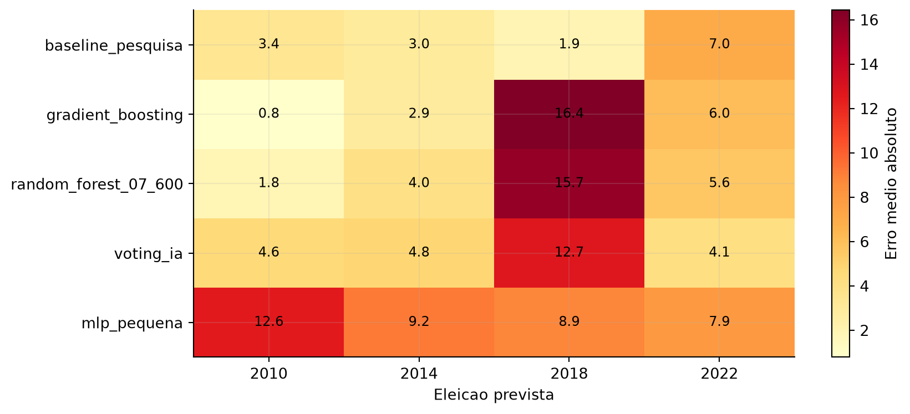

Erro absoluto medio por modelo e eleicao no backtest cronologico

|  | modelo | candidato | eleicoes | erro_medio | pior_erro |
| --- | --- | --- | --- | --- | --- |
| 37 | random_forest_07_600 | João Amoêdo | 1 | 27.19 | 27.19 |
| 17 | gradient_boosting | João Amoêdo | 1 | 26.20 | 26.20 |
| 14 | gradient_boosting | Geraldo Alckmin | 1 | 25.48 | 25.48 |
| 34 | random_forest_07_600 | Geraldo Alckmin | 1 | 24.95 | 24.95 |
| 47 | voting_ia | João Amoêdo | 1 | 21.53 | 21.53 |
| 44 | voting_ia | Geraldo Alckmin | 1 | 20.43 | 20.43 |
| 22 | mlp_pequena | Dilma Rousseff | 2 | 16.46 | 19.93 |
| 21 | mlp_pequena | Ciro Gomes | 2 | 10.15 | 27.80 |
| 25 | mlp_pequena | Jair Bolsonaro | 2 | 9.90 | 21.45 |
| 8 | baseline_pesquisa | Lula | 1 | 8.85 | 28.66 |
| 38 | random_forest_07_600 | Lula | 1 | 8.63 | 17.93 |
| 23 | mlp_pequena | Fernando Haddad | 1 | 8.23 | 8.23 |
| 18 | gradient_boosting | Lula | 1 | 8.21 | 21.74 |
| 15 | gradient_boosting | Jair Bolsonaro | 2 | 7.76 | 19.12 |
| 42 | voting_ia | Dilma Rousseff | 2 | 7.61 | 7.86 |
| 5 | baseline_pesquisa | Jair Bolsonaro | 2 | 7.04 | 17.56 |
| 48 | voting_ia | Lula | 1 | 6.64 | 20.34 |
| 43 | voting_ia | Fernando Haddad | 1 | 6.42 | 6.42 |
| 35 | random_forest_07_600 | Jair Bolsonaro | 2 | 6.04 | 17.50 |
| 28 | mlp_pequena | Lula | 1 | 5.96 | 9.77 |
| 1 | baseline_pesquisa | Ciro Gomes | 2 | 5.73 | 12.18 |
| 13 | gradient_boosting | Fernando Haddad | 1 | 5.70 | 5.70 |
| 11 | gradient_boosting | Ciro Gomes | 2 | 5.68 | 19.67 |
| 31 | random_forest_07_600 | Ciro Gomes | 2 | 5.62 | 18.19 |
| 20 | mlp_pequena | Aécio Neves | 1 | 5.41 | 5.41 |
| 26 | mlp_pequena | José Serra | 1 | 5.20 | 5.20 |
| 24 | mlp_pequena | Geraldo Alckmin | 1 | 4.76 | 4.76 |
| 32 | random_forest_07_600 | Dilma Rousseff | 2 | 4.74 | 6.30 |
| 3 | baseline_pesquisa | Fernando Haddad | 1 | 4.30 | 4.30 |
| 2 | baseline_pesquisa | Dilma Rousseff | 2 | 3.78 | 5.16 |
| 45 | voting_ia | Jair Bolsonaro | 2 | 3.77 | 23.94 |
| 41 | voting_ia | Ciro Gomes | 2 | 3.74 | 14.85 |
| 0 | baseline_pesquisa | Aécio Neves | 1 | 3.55 | 3.55 |
| 29 | mlp_pequena | Simone Tebet | 1 | 3.22 | 4.16 |
| 33 | random_forest_07_600 | Fernando Haddad | 1 | 3.17 | 3.17 |

|  | ano_eleicao | modelo | candidato | previsto | resultado_real_validos | erro_abs |
| --- | --- | --- | --- | --- | --- | --- |
| 346 | 2022 | baseline_pesquisa | Lula | 19.77 | 48.43 | 28.66 |
| 1002 | 2022 | mlp_pequena | Ciro Gomes | 30.84 | 3.04 | 27.80 |
| 196 | 2018 | random_forest_07_600 | João Amoêdo | 29.69 | 2.50 | 27.19 |
| 276 | 2018 | gradient_boosting | João Amoêdo | 28.70 | 2.50 | 26.20 |
| 274 | 2018 | gradient_boosting | Geraldo Alckmin | 30.24 | 4.76 | 25.48 |
| 194 | 2018 | random_forest_07_600 | Geraldo Alckmin | 29.71 | 4.76 | 24.95 |
| 1096 | 2022 | voting_ia | Jair Bolsonaro | 19.26 | 43.20 | 23.94 |
| 874 | 2022 | gradient_boosting | Lula | 26.69 | 48.43 | 21.74 |
| 326 | 2018 | voting_ia | João Amoêdo | 24.03 | 2.50 | 21.53 |
| 1003 | 2022 | mlp_pequena | Jair Bolsonaro | 64.65 | 43.20 | 21.45 |
| 324 | 2018 | voting_ia | Geraldo Alckmin | 25.19 | 4.76 | 20.43 |
| 1094 | 2022 | voting_ia | Lula | 28.09 | 48.43 | 20.34 |
| 60 | 2010 | mlp_pequena | Dilma Rousseff | 66.84 | 46.91 | 19.93 |
| 272 | 2018 | gradient_boosting | Ciro Gomes | 32.14 | 12.47 | 19.67 |
| 876 | 2022 | gradient_boosting | Jair Bolsonaro | 24.08 | 43.20 | 19.12 |
| 192 | 2018 | random_forest_07_600 | Ciro Gomes | 30.66 | 12.47 | 18.19 |
| 522 | 2022 | random_forest_07_600 | Lula | 30.50 | 48.43 | 17.93 |
| 348 | 2022 | baseline_pesquisa | Jair Bolsonaro | 25.64 | 43.20 | 17.56 |
| 524 | 2022 | random_forest_07_600 | Jair Bolsonaro | 25.70 | 43.20 | 17.50 |
| 305 | 2018 | mlp_pequena | Jair Bolsonaro | 28.88 | 46.03 | 17.15 |
| 1005 | 2022 | mlp_pequena | Jair Bolsonaro | 60.27 | 43.20 | 17.07 |
| 1011 | 2022 | mlp_pequena | Ciro Gomes | 19.91 | 3.04 | 16.87 |
| 322 | 2018 | voting_ia | Ciro Gomes | 27.32 | 12.47 | 14.85 |
| 1004 | 2022 | mlp_pequena | Ciro Gomes | 16.55 | 3.04 | 13.51 |
| 137 | 2014 | mlp_pequena | Dilma Rousseff | 54.58 | 41.59 | 12.99 |
| 351 | 2022 | baseline_pesquisa | Ciro Gomes | 15.22 | 3.04 | 12.18 |
| 342 | 2022 | baseline_pesquisa | Ciro Gomes | 14.73 | 3.04 | 11.69 |
| 302 | 2018 | mlp_pequena | Ciro Gomes | 0.84 | 12.47 | 11.63 |
| 1012 | 2022 | mlp_pequena | Jair Bolsonaro | 54.43 | 43.20 | 11.23 |
| 1022 | 2022 | mlp_pequena | Lula | 38.66 | 48.43 | 9.77 |

### Previsao de 2026 por modelo

Depois da avaliacao historica, os mesmos modelos sao treinados com todas as eleicoes disponiveis ate 2022 e aplicados aos cenarios principais de 2026.

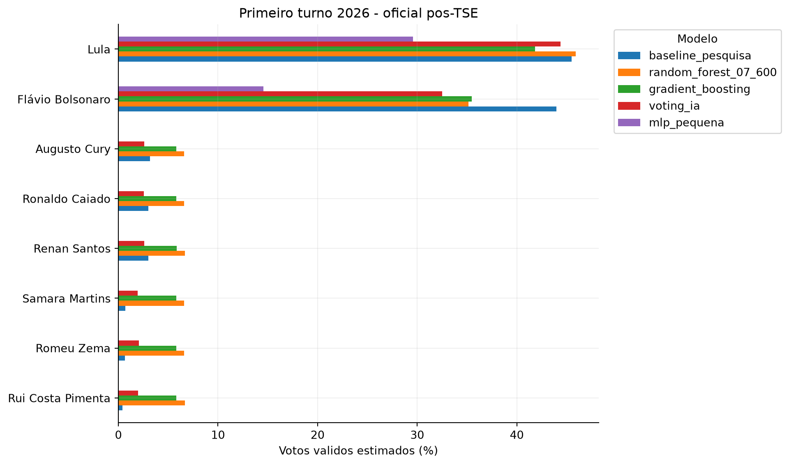

Previsao de 2026 por modelo, treinada com eleicoes ate 2022

|  | modelo | cenario_rotulo | candidato | previsto | ano_treino_max |
| --- | --- | --- | --- | --- | --- |
| 46 | baseline_pesquisa | Primeiro turno 2026 - oficial pos-TSE | Augusto Cury | 3.18 | 2022 |
| 1606 | gradient_boosting | Primeiro turno 2026 - oficial pos-TSE | Augusto Cury | 5.81 | 2022 |
| 1996 | mlp_pequena | Primeiro turno 2026 - oficial pos-TSE | Augusto Cury | 0.00 | 2022 |
| 566 | random_forest_07_600 | Primeiro turno 2026 - oficial pos-TSE | Augusto Cury | 6.80 | 2022 |
| 2256 | voting_ia | Primeiro turno 2026 - oficial pos-TSE | Augusto Cury | 2.62 | 2022 |
| 49 | baseline_pesquisa | Primeiro turno 2026 - oficial pos-TSE | Flávio Bolsonaro | 43.97 | 2022 |
| 1609 | gradient_boosting | Primeiro turno 2026 - oficial pos-TSE | Flávio Bolsonaro | 35.62 | 2022 |
| 1999 | mlp_pequena | Primeiro turno 2026 - oficial pos-TSE | Flávio Bolsonaro | 14.55 | 2022 |
| 569 | random_forest_07_600 | Primeiro turno 2026 - oficial pos-TSE | Flávio Bolsonaro | 35.22 | 2022 |
| 2259 | voting_ia | Primeiro turno 2026 - oficial pos-TSE | Flávio Bolsonaro | 32.77 | 2022 |
| 51 | baseline_pesquisa | Primeiro turno 2026 - oficial pos-TSE | Lula | 45.51 | 2022 |
| 1611 | gradient_boosting | Primeiro turno 2026 - oficial pos-TSE | Lula | 41.99 | 2022 |
| 2001 | mlp_pequena | Primeiro turno 2026 - oficial pos-TSE | Lula | 29.58 | 2022 |
| 571 | random_forest_07_600 | Primeiro turno 2026 - oficial pos-TSE | Lula | 45.61 | 2022 |
| 2261 | voting_ia | Primeiro turno 2026 - oficial pos-TSE | Lula | 44.58 | 2022 |
| 52 | baseline_pesquisa | Primeiro turno 2026 - oficial pos-TSE | Renan Santos | 2.99 | 2022 |
| 1612 | gradient_boosting | Primeiro turno 2026 - oficial pos-TSE | Renan Santos | 5.88 | 2022 |
| 2002 | mlp_pequena | Primeiro turno 2026 - oficial pos-TSE | Renan Santos | 0.00 | 2022 |
| 572 | random_forest_07_600 | Primeiro turno 2026 - oficial pos-TSE | Renan Santos | 6.90 | 2022 |
| 2262 | voting_ia | Primeiro turno 2026 - oficial pos-TSE | Renan Santos | 2.64 | 2022 |
| 53 | baseline_pesquisa | Primeiro turno 2026 - oficial pos-TSE | Romeu Zema | 0.65 | 2022 |
| 1613 | gradient_boosting | Primeiro turno 2026 - oficial pos-TSE | Romeu Zema | 5.81 | 2022 |
| 2003 | mlp_pequena | Primeiro turno 2026 - oficial pos-TSE | Romeu Zema | 0.00 | 2022 |
| 573 | random_forest_07_600 | Primeiro turno 2026 - oficial pos-TSE | Romeu Zema | 6.81 | 2022 |
| 2263 | voting_ia | Primeiro turno 2026 - oficial pos-TSE | Romeu Zema | 2.10 | 2022 |
| 54 | baseline_pesquisa | Primeiro turno 2026 - oficial pos-TSE | Ronaldo Caiado | 3.02 | 2022 |
| 1614 | gradient_boosting | Primeiro turno 2026 - oficial pos-TSE | Ronaldo Caiado | 5.81 | 2022 |
| 2004 | mlp_pequena | Primeiro turno 2026 - oficial pos-TSE | Ronaldo Caiado | 0.00 | 2022 |
| 574 | random_forest_07_600 | Primeiro turno 2026 - oficial pos-TSE | Ronaldo Caiado | 6.80 | 2022 |
| 2264 | voting_ia | Primeiro turno 2026 - oficial pos-TSE | Ronaldo Caiado | 2.59 | 2022 |
| 55 | baseline_pesquisa | Primeiro turno 2026 - oficial pos-TSE | Rui Costa Pimenta | 0.43 | 2022 |
| 1615 | gradient_boosting | Primeiro turno 2026 - oficial pos-TSE | Rui Costa Pimenta | 5.81 | 2022 |
| 2005 | mlp_pequena | Primeiro turno 2026 - oficial pos-TSE | Rui Costa Pimenta | 0.00 | 2022 |
| 575 | random_forest_07_600 | Primeiro turno 2026 - oficial pos-TSE | Rui Costa Pimenta | 6.83 | 2022 |
| 2265 | voting_ia | Primeiro turno 2026 - oficial pos-TSE | Rui Costa Pimenta | 2.01 | 2022 |
| 56 | baseline_pesquisa | Primeiro turno 2026 - oficial pos-TSE | Samara Martins | 0.71 | 2022 |
| 1616 | gradient_boosting | Primeiro turno 2026 - oficial pos-TSE | Samara Martins | 5.81 | 2022 |
| 2006 | mlp_pequena | Primeiro turno 2026 - oficial pos-TSE | Samara Martins | 0.00 | 2022 |
| 576 | random_forest_07_600 | Primeiro turno 2026 - oficial pos-TSE | Samara Martins | 6.74 | 2022 |
| 2266 | voting_ia | Primeiro turno 2026 - oficial pos-TSE | Samara Martins | 2.00 | 2022 |

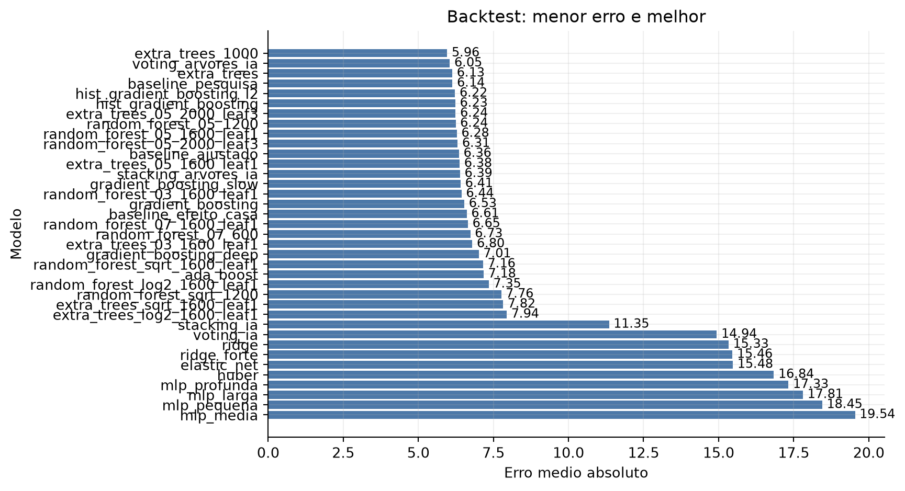

Erro medio absoluto no backtest por modelo

### Backtest ponderado pela qualidade da base

O ranking bruto trata 1994, 1998 e 2022 como se tivessem a mesma confiabilidade de medicao. O ranking ponderado abaixo reduz o peso de anos com pouca cobertura, poucos institutos, muita amostra imputada ou dependencia forte de base agregada.

|  | ano_eleicao | pesquisas_cenarios | institutos | base_agregada_pct | amostra_imputada_pct | peso_qualidade_base |
| --- | --- | --- | --- | --- | --- | --- |
| 0 | 1994 | 18 | 2 | 0.00000 | 83.333333 | 0.70 |
| 1 | 1998 | 14 | 3 | 0.00000 | 64.285714 | 0.85 |
| 2 | 2002 | 130 | 6 | 0.00000 | 99.230769 | 0.85 |
| 3 | 2006 | 7 | 3 | 0.00000 | 14.285714 | 0.80 |
| 4 | 2010 | 85 | 11 | 100.00000 | 100.000000 | 0.65 |
| 5 | 2014 | 27 | 7 | 100.00000 | 0.000000 | 0.80 |
| 6 | 2018 | 34 | 13 | 100.00000 | 0.000000 | 0.80 |
| 7 | 2022 | 137 | 31 | 100.00000 | 0.000000 | 0.80 |
| 8 | 2026 | 127 | 21 | 59.84252 | 0.000000 | 0.80 |

|  | modelo | mae_bruto | mae_ponderado | delta |
| --- | --- | --- | --- | --- |
| 9 | extra_trees_1000 | 5.96 | 5.99 | 0.03 |
| 3 | baseline_pesquisa | 6.14 | 6.01 | -0.13 |
| 35 | voting_arvores_ia | 6.05 | 6.09 | 0.04 |
| 5 | extra_trees | 6.13 | 6.14 | 0.01 |
| 16 | hist_gradient_boosting_l2 | 6.22 | 6.15 | -0.07 |
| 15 | hist_gradient_boosting | 6.23 | 6.15 | -0.08 |
| 1 | baseline_ajustado | 6.36 | 6.22 | -0.14 |
| 8 | extra_trees_05_2000_leaf3 | 6.24 | 6.24 | -0.01 |
| 23 | random_forest_05_1200 | 6.24 | 6.28 | 0.03 |
| 24 | random_forest_05_1600_leaf1 | 6.28 | 6.32 | 0.04 |
| 7 | extra_trees_05_1600_leaf1 | 6.38 | 6.34 | -0.03 |
| 25 | random_forest_05_2000_leaf3 | 6.31 | 6.34 | 0.04 |

### Calibracao da incerteza

Os intervalos atuais sao derivados do erro medio historico de cada modelo. A tabela abaixo traduz esse erro em uma leitura operacional: se o erro historico seguir uma distribuicao aproximadamente normal, qual fracao dos casos cairia dentro do intervalo usado hoje?

|  | modelo | mae | intervalo_meia_largura | sigma_aproximado | cobertura_aproximada_pct | leitura |
| --- | --- | --- | --- | --- | --- | --- |
| 9 | extra_trees_1000 | 5.96 | 11.68 | 7.471775 | 88.21 | larga/conservadora |
| 35 | voting_arvores_ia | 6.05 | 11.86 | 7.581966 | 88.21 | larga/conservadora |
| 5 | extra_trees | 6.13 | 12.02 | 7.685978 | 88.21 | larga/conservadora |
| 3 | baseline_pesquisa | 6.14 | 12.03 | 7.692389 | 88.21 | larga/conservadora |
| 16 | hist_gradient_boosting_l2 | 6.22 | 12.20 | 7.800902 | 88.21 | larga/conservadora |
| 15 | hist_gradient_boosting | 6.23 | 12.22 | 7.813159 | 88.21 | larga/conservadora |
| 23 | random_forest_05_1200 | 6.24 | 12.24 | 7.824825 | 88.21 | larga/conservadora |
| 8 | extra_trees_05_2000_leaf3 | 6.24 | 12.23 | 7.823451 | 88.21 | larga/conservadora |
| 24 | random_forest_05_1600_leaf1 | 6.28 | 12.32 | 7.875614 | 88.21 | larga/conservadora |
| 25 | random_forest_05_2000_leaf3 | 6.31 | 12.37 | 7.907578 | 88.21 | larga/conservadora |
| 1 | baseline_ajustado | 6.36 | 12.46 | 7.965854 | 88.21 | larga/conservadora |
| 7 | extra_trees_05_1600_leaf1 | 6.38 | 12.50 | 7.992755 | 88.21 | larga/conservadora |
| 33 | stacking_arvores_ia | 6.39 | 12.52 | 8.008127 | 88.21 | larga/conservadora |
| 14 | gradient_boosting_slow | 6.41 | 12.56 | 8.032556 | 88.21 | larga/conservadora |
| 22 | random_forest_03_1600_leaf1 | 6.44 | 12.62 | 8.070520 | 88.21 | larga/conservadora |
| 12 | gradient_boosting | 6.53 | 12.80 | 8.187463 | 88.21 | larga/conservadora |
| 2 | baseline_efeito_casa | 6.61 | 12.96 | 8.288349 | 88.21 | larga/conservadora |
| 26 | random_forest_07_1600_leaf1 | 6.65 | 13.04 | 8.337357 | 88.21 | larga/conservadora |
| 27 | random_forest_07_600 | 6.73 | 13.20 | 8.437920 | 88.21 | larga/conservadora |
| 6 | extra_trees_03_1600_leaf1 | 6.80 | 13.32 | 8.520239 | 88.21 | larga/conservadora |
| 13 | gradient_boosting_deep | 7.01 | 13.74 | 8.788681 | 88.21 | larga/conservadora |
| 30 | random_forest_sqrt_1600_leaf1 | 7.16 | 14.03 | 8.971231 | 88.21 | larga/conservadora |
| 0 | ada_boost | 7.18 | 14.06 | 8.993304 | 88.21 | larga/conservadora |
| 28 | random_forest_log2_1600_leaf1 | 7.35 | 14.40 | 9.207784 | 88.21 | larga/conservadora |
| 29 | random_forest_sqrt_1200 | 7.76 | 15.21 | 9.725938 | 88.21 | larga/conservadora |
| 11 | extra_trees_sqrt_1600_leaf1 | 7.82 | 15.34 | 9.806765 | 88.21 | larga/conservadora |
| 10 | extra_trees_log2_1600_leaf1 | 7.94 | 15.57 | 9.956277 | 88.21 | larga/conservadora |
| 34 | stacking_ia | 11.35 | 18.00 | 14.228124 | 79.42 | razoavel |
| 36 | voting_ia | 14.94 | 18.00 | 18.725267 | 66.36 | estreita |
| 31 | ridge | 15.33 | 18.00 | 19.215507 | 65.11 | estreita |
| 32 | ridge_forte | 15.46 | 18.00 | 19.378280 | 64.70 | estreita |
| 4 | elastic_net | 15.48 | 18.00 | 19.397632 | 64.66 | estreita |
| 17 | huber | 16.84 | 18.00 | 21.106189 | 60.62 | estreita |
| 21 | mlp_profunda | 17.33 | 18.00 | 21.714158 | 59.29 | estreita |
| 18 | mlp_larga | 17.81 | 18.00 | 22.321480 | 58.00 | estreita |
| 20 | mlp_pequena | 18.45 | 18.00 | 23.126336 | 56.36 | estreita |
| 19 | mlp_media | 19.54 | 18.00 | 24.493324 | 53.76 | estreita |

|  | candidato | voto_valido_estimado | intervalo_baixo | intervalo_alto | meia_largura |
| --- | --- | --- | --- | --- | --- |
| 0 | Lula | 44.2850 | 42.2850 | 46.2850 | 2.00 |
| 1 | Flávio Bolsonaro | 41.7018 | 39.7018 | 43.7018 | 2.00 |
| 2 | Augusto Cury | 4.0446 | 2.0446 | 6.0446 | 2.00 |
| 3 | Renan Santos | 3.7576 | 1.7576 | 5.7576 | 2.00 |
| 4 | Ronaldo Caiado | 3.0718 | 1.0718 | 5.0718 | 2.00 |
| 5 | Romeu Zema | 0.9606 | 0.0000 | 2.9606 | 1.48 |

|  | ano_teste | modelo | linhas_treino | linhas_teste | mae |
| --- | --- | --- | --- | --- | --- |
| 26 | 1994 | hist_gradient_boosting | 1323 | 74 | 6.386259 |
| 27 | 1994 | hist_gradient_boosting_l2 | 1323 | 74 | 6.435887 |
| 35 | 1994 | voting_arvores_ia | 1323 | 74 | 6.644317 |
| 8 | 1994 | random_forest_05_1200 | 1323 | 74 | 6.789437 |
| 0 | 1994 | baseline_pesquisa | 1323 | 74 | 7.580281 |
| ... | ... | ... | ... | ... | ... |
| 294 | 2022 | voting_arvores_ia | 923 | 474 | 4.263341 |
| 275 | 2022 | extra_trees | 923 | 474 | 4.308344 |
| 276 | 2022 | extra_trees_1000 | 923 | 474 | 4.540220 |
| 281 | 2022 | extra_trees_05_2000_leaf3 | 923 | 474 | 4.820855 |
| 259 | 2022 | baseline_pesquisa | 923 | 474 | 5.029296 |

64 rows × 5 columns

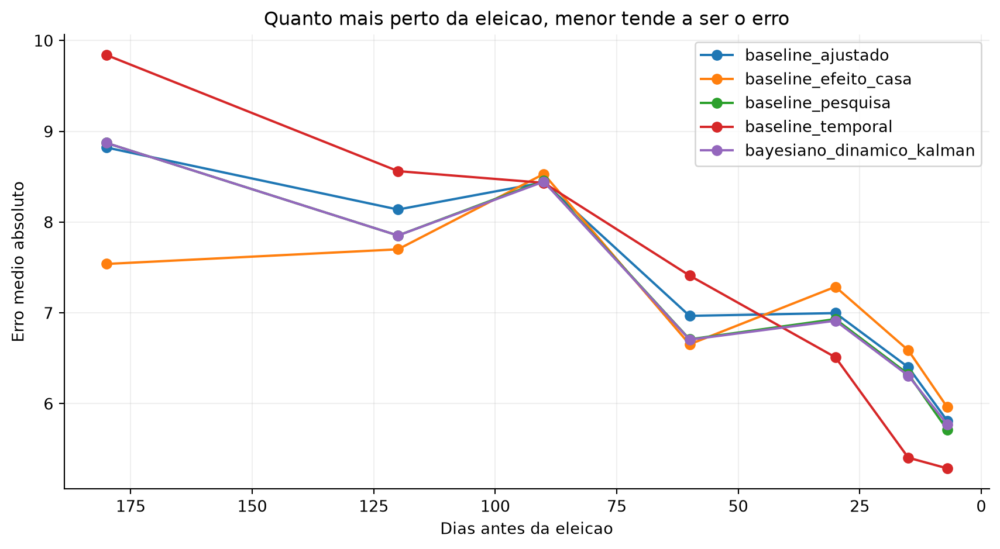

Erro do baseline por dias antes da eleicao

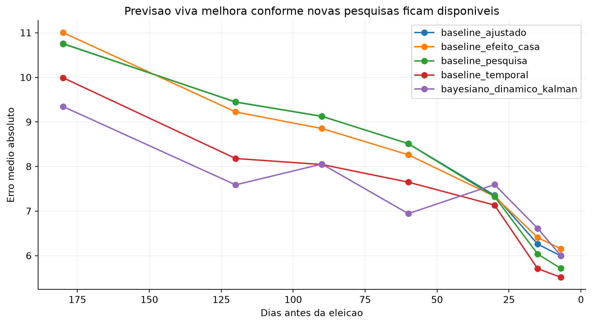

Simulacao de previsao viva: usa apenas pesquisas publicadas ate cada corte

### Proximas entregas

Nenhuma pendencia operacional aberta nos filtros atuais.

Depois desta fila operacional, as melhorias de modelo continuam sendo: melhorar o Bayesiano dinamico com efeito de instituto e fundamentos como prior; ampliar series nacionais antigas; adicionar aprovacao do governo, rejeicao e renda real.
